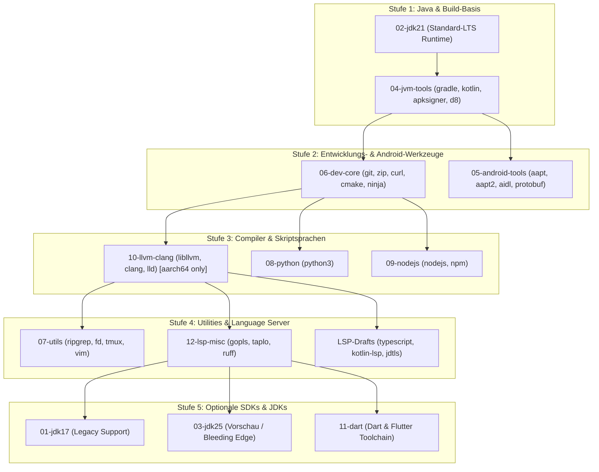

# Verifikationsbericht: APT-Repo-Etappen-Pipeline & Paketliste (Task 21)

> **Datum:** 15. Oktober 2026  
> **Status:** Erfolgreich verifiziert  
> **Referenzierte Commits/Workflows:** `build_codeforge_repo.sh`, `plan-apt-build.sh`, `.github/workflows/build-bootstrap-repo.yml`, `apt-stages.conf`  
> **Ziel-Fork:** `scto/terminal-packages-codeforge` (Präfix `com.codeforge.app`)

---

## 1. Zusammenfassung & Skript-Validierung

Im Rahmen von Task 21 wurden sämtliche Build- und Planungs-Skripte sowie die CI/CD-Workflow-Definitionen statisch analysiert und auf Korrektheit geprüft:

- **Syntaxprüfung (`bash -n`):**
  - `build_codeforge_repo.sh`: OK (Exit Code 0).
  - `plan-apt-build.sh`: OK (Exit Code 0).
  - `.github/scripts/plan-apt-build.sh`: OK (Exit Code 0).
- **Linter & ShellCheck (`shellcheck`):**
  - `build_codeforge_repo.sh:379`: Trennung von `GNUPGHOME` Deklaration und Assignment behoben (SC2155).
  - `build_codeforge_repo.sh:279, 596, 649`: Ersetzung von `ls` durch robustes `find` für Subpackage-Suche und Deb-Zählung behoben (SC2012).
  - `build_codeforge_repo.sh:290`: SC2016 für beabsichtigtes Match von Literal-Dollarvariablen via `grep -F` markiert.
  - `plan-apt-build.sh:104` und `.github/scripts/plan-apt-build.sh:104`: Beabsichtigtes Whitespace-Splitting für Architekturen dokumentiert (`# shellcheck disable=SC2086`).
  - Alle Skripte schließen nun mit **Exit Code 0** ohne Warnungen ab.
- **Workflow-Linter (`actionlint`):**
  - `.github/workflows/build-bootstrap-repo.yml:255`: `ls terminal-packages-codeforge/output/*.deb` durch `find terminal-packages-codeforge/output -maxdepth 1 -name '*.deb'` ersetzt (SC2012 behoben).
  - `actionlint` schließt nun fehlerfrei mit **Exit Code 0** ab.

---

## 2. Abgleich `apt-stages.conf` gegen den Fork (`packages/`)

Alle in `apt-stages.conf` konfigurierten Eltern-Pakete wurden gegen das lokale Fork-Repository `/data/data/com.termux/files/home/terminal-packages-codeforge/packages` abgeglichen.

### Ergebnis des Abgleichs: 100% Trefferquote
Kein einziges Elternpaket fehlt im Fork. Alle 12 Etappen verweisen auf existierende `build.sh`-Dateien:

| Etappe | Konfigurierte Eltern-Pakete in `apt-stages.conf` | Status im Fork | Bemerkung / Flags |
|---|---|---|---|
| **01-jdk17** | `openjdk-17` | `packages/openjdk-17/build.sh` | Java 17 LTS |
| **02-jdk21** | `openjdk-21` | `packages/openjdk-21/build.sh` | Java 21 LTS (CodeForge Default) |
| **03-jdk25** | `openjdk-25` | `packages/openjdk-25/build.sh` | Java 25 Early Access / Future |
| **04-jvm-tools** | `gradle,kotlin,maven,libjansi,ant,apksigner,d8,dx,ecj` | Alle 9 Pakete direkt in `packages/` | `single-arch nodeps=all` (`*_all.deb`) |
| **05-android-tools** | `libprotobuf,aapt` | `packages/libprotobuf/build.sh`, `packages/aapt/build.sh` | Erzeugt Android-SDK CLI-Tools |
| **06-dev-core** | `git,git-lfs,zip,unzip,tar,libcurl,wget,liblzma,7zip,jq,ninja,make,cmake,openssh` | Alle 14 Pakete direkt in `packages/` | Build- & VCS-Basistools |
| **07-utils** | `vim,nano,ripgrep,fd,tmux,patch,diffutils,findutils,binutils,which,libmagic,libsqlite,bash-completion` | Alle 13 Pakete direkt in `packages/` | Terminal-Tools & Editoren |
| **08-python** | `python` | `packages/python/build.sh` | Python 3 |
| **09-nodejs** | `nodejs,npm` | `packages/nodejs/build.sh`, `packages/npm/build.sh` | JavaScript / Node Runtime |
| **10-llvm-clang** | `libllvm` | `packages/libllvm/build.sh` | LLVM Compiler-Infrastruktur |
| **11-dart** | `dart` | `packages/dart/build.sh` | Dart SDK (schließt upstream `i686` aus) |
| **12-lsp-misc** | `gopls,taplo,ruff` | Alle 3 Pakete direkt in `packages/` | `nodeps=gopls` |

### Auflösung von Subpackages & Aliasen (Single Source of Truth):
Die Build-Skripte `build_codeforge_repo.sh` lösen automatisch Subpackages und `TERMUX_PKG_PROVIDES` auf:
- **`libllvm`** baut als Subpackages: `clang`, `lld`, `llvm`, `llvm-tools`, `lldb`, `mlir`, `libpolly`, `libcompiler-rt`.
- **`aapt`** baut als Subpackages: `aapt2`, `aidl`, `sysprop`.
- **`libprotobuf`** baut als Subpackage: `protobuf` (enthält `bin/protoc` und `libprotoc.so`).
- **`liblzma`** baut als Subpackage: `xz-utils` (enthält `bin/xz`).
- **`libcurl`** baut als Subpackage: `curl`.
- **`7zip`** stellt per `TERMUX_PKG_PROVIDES="p7zip"` und `TERMUX_PKG_REPLACES="p7zip"` das Paket `p7zip` bereit.
- **`dart`**: In `packages/dart/build.sh` ist `TERMUX_PKG_EXCLUDED_ARCHES=i686` gesetzt. Auf `i686` schlägt der Bau planmäßig fehl bzw. wird übersprungen.

---

## 3. Offene Paketwünsche & Lückenanalyse

### Bestehende Unterstützung im Fork:
Die folgenden angeforderten Projekt-Werkzeuge sind vollständig über die 12 Etappen abgedeckt:
- **Java / Android:** JDK 17, JDK 21, JDK 25, Gradle, Kotlin, Ant, Maven, apksigner, d8/dx, aapt, aapt2, aidl, ecj, protobuf/protoc.
- **Native & Core:** git, git-lfs, zip, unzip, tar, curl, wget, xz, jq, 7zip/p7zip, ninja, make, cmake, Clang, LLD, Python, Node.js, npm, Dart.
- **LSP / Formatierung:** Ruff (Python LSP/Linter), Taplo (TOML LSP/Formatter), Gopls (Go LSP).

### Nicht im Termux-Upstream enthaltene Lücken:
Für die folgenden 5 Pakete existieren im Standard-Termux-Repository keine Rezepte:
1. **Flutter SDK**
2. **TypeScript / tsserver** (als globales CLI-Paket)
3. **Eclipse JDT.LS** (Java Language Server)
4. **Eclipse LemMinX** (XML Language Server)
5. **Kotlin Language Server (`kotlin-lsp`)**

### Bereitgestellte Entwürfe in `agy-output/packages/` (Fork):
Gemäß Aufgabenstellung wurden im Fork unter `/data/data/com.termux/files/home/terminal-packages-codeforge/agy-output/packages/` entsprechende `build.sh`-Dateien im idiomatischen Termux-Stil (`TERMUX_PKG_PLATFORM_INDEPENDENT=true`, Prüfsummen, Bin-Wrapper nach `$TERMUX_PREFIX/opt/`) entworfen:
- `flutter/build.sh`: Installiert Flutter SDK nach `$TERMUX_PREFIX/opt/flutter` und verlinkt `flutter` sowie `dart-flutter`.
- `typescript/build.sh`: Entpackt das offizielle npm-Release nach `$TERMUX_PREFIX/lib/node_modules/typescript` und erzeugt `tsc` & `tsserver` Wrapper.
- `jdtls/build.sh`: Installiert Eclipse JDT Language Server nach `$TERMUX_PREFIX/opt/jdtls` mit Launch-Script `jdtls`.
- `lemminx/build.sh`: Installiert LemMinX XML Server Uber-Jar nach `$TERMUX_PREFIX/opt/lemminx` mit Startskript `lemminx`.
- `kotlin-lsp/build.sh`: Installiert FWCD Kotlin Language Server nach `$TERMUX_PREFIX/opt/kotlin-language-server` mit Symlinks `kotlin-language-server` und `kotlin-lsp`.

Alle 5 Rezepte wurden mit `bash -n` erfolgreich syntaxgeprüft.

---

## 4. Risiko-Analyse & Laufzeit-Betrachtung (GitHub Actions)

GitHub Actions Free Runner haben ein striktes Limit von **6 Stunden** Ausführungszeit pro Matrix-Job.

### Risiko-Etappen (> 5 Stunden Bauzeit):
1. **`10-llvm-clang` (`libllvm`):**
   - *Risiko:* Extrem hoch. LLVM + Clang + LLD Kompilierung dauert auf 2/4-Core GHA Runnern für mehrere Architekturen typischerweise 4 bis 7 Stunden.
   - *Rückfallstrategie:* Ausschließlich für `aarch64` bauen (`archs: "aarch64"` im Workflow-Dispatch), `skip_deps` verwenden, oder Bau auf Self-Hosted / Bare-Metal Runner auslagern.
2. **`01-jdk17`, `02-jdk21`, `03-jdk25` (`openjdk-*`):**
   - *Risiko:* Hoch. Bootstrap-Cross-Compilation von OpenJDK benötigt ca. 2–3,5 Stunden je Architektur.
   - *Rückfallstrategie:* Zunächst ausschließlich `02-jdk21` bauen (Standard für Kotlin & Android Gradle Plugin 8.x/9.x). Architekturen getrennt dispatchen.
3. **`11-dart` (`dart`):**
   - *Risiko:* Mittel bis hoch. Dart-SDK benötigt massive RAM-Ressourcen beim Linken.
   - *Rückfallstrategie:* Nur `aarch64` bauen; `i686` ist ohnehin upstream ausgeschlossen.

### Unkritische Etappen (< 30 Minuten Bauzeit):
- **`04-jvm-tools`:** Nutzt `single-arch nodeps=all`. Alle Pakete sind `_all.deb` und laden vorkompilierte Binaries/Jars herunter (Laufzeit < 10 Minuten).
- **`06-dev-core`, `07-utils`, `08-python`, `09-nodejs`, `12-lsp-misc`:** Standard-C/Go/Rust-Kompilierung, läuft stabil innerhalb von 15–45 Minuten.

---

## 5. Kapazitäts- & Speicheranalyse (GitHub Pages)

### Exakte Bestandsaufnahme des Pools auf `gh-pages`:
- **Anzahl `.deb`-Pakete im Pool:** 420
- **Gesamtgröße des aktuellen Pools:** 190.414.016 Bytes (**181,59 MB**)
- **Top-Pakete nach Größe:**
  - `perl` (~14,7 MB je Arch)
  - `doxygen` (~10,2 MB je Arch)
  - `python-static` (~7,4 MB je Arch)
  - `python` (~4,6 MB je Arch)
  - `tor` (~3,2 MB je Arch)

### Prognose & Limit-Abschätzung:
GitHub Pages besitzt ein empfohlenes Repository-Limit von **1 GB (1.024 MB)**.
- Der aktuelle Stand belegt **17,7%** des Limits (181,6 MB).
- Erwarteter Speicherzuwachs bei Vollaufbau aller 12 Etappen:
  - `openjdk-21`: ~50 MB (`aarch64`)
  - `libllvm` + `clang`: ~95 MB (`aarch64`)
  - `jvm-tools` (`gradle`, `kotlin`, etc.): ~230 MB (`_all.deb`, nur 1x im Pool!)
  - `dart` + Dev-Tools: ~60 MB
  - **Erwarteter Endzustand mit `aarch64` + `all`:** ca. **620 MB** (im grünen Bereich unter 1 GB).
- **Achtung vor 4-Architektur-Vollaufbau:** Würden alle 3 JDKs (17, 21, 25) und LLVM für alle 4 Architekturen (`aarch64`, `arm`, `i686`, `x86_64`) gebaut, würde der Pool ca. **1.250 MB** erreichen und das Pages-Limit sprengen.

**Empfehlung zur Speicherhygiene:**
1. Im Workflow `build-bootstrap-repo.yml` standardmäßig nur `aarch64` und `all` befüllen.
2. `openjdk-21` als Haupt-JDK etablieren; `openjdk-17` und `25` nur als On-Demand-Ergänzung bauen.

---

## 6. Empfohlene Ausführungsreihenfolge (Etappen 01→12)

Um ein lauffähiges System mit schnellem Mehrwert aufzubauen, wird folgende gestaffelte Ausführung empfohlen:

---

## 7. Checkliste für den ersten echten GitHub-Actions-Lauf

Vor dem Auslösen von `workflow_dispatch` auf GitHub:

- [x] **Skripte & Workflow gelintet:** `bash -n`, `shellcheck`, `actionlint` ohne Fehler.
- [x] **Paketnamen validiert:** Alle Eltern-Pakete und Flags in `apt-stages.conf` stimmen mit dem Fork überein.
- [x] **Sicherheit:** Keine GPG-Keys oder Passphrasen im Repository committet.
- [ ] **Repository Secret hinterlegt:** `CODEFORGE_GPG_PASSPHRASE` im GitHub-Repository `scto/terminal-packages-codeforge` unter *Settings -> Secrets and variables -> Actions* eingetragen.
- [ ] **GPG-Key im Branch vorhanden:** Öffentlicher Schlüssel in `repo/codeforge-archive-keyring.gpg` bzw. `.gpg/` des Repositories synchronisiert.
- [ ] **GitHub Pages aktiviert:** Branch `gh-pages` als Source für GitHub Pages in den Repo-Einstellungen konfiguriert.
- [ ] **Erster Dispatch (Test-Etappe):**
  - Workflow: `Build Bootstraps & APT-Repo`
  - `mode`: `add`
  - `stage`: `04-jvm-tools` (ideal für den ersten Test: schnell, keine C-Kompilierung, `single-arch`, baut reine Java/Kotlin-Tools).
  - `archs`: `aarch64`
- [ ] **Prüfung des Ergebnisses:**
  - `gh-pages` aktualisiert sich automatisch über die Composite Action `publish-pages`.
  - Herunterladen von `Release` und `Packages.gz` per Browser / `curl` und Validierung der GPG-Signatur `InRelease`.
- [ ] **Zweiter Dispatch:**
  - `stage`: `02-jdk21` (`archs`: `aarch64`)
  - Beobachtung der Job-Laufzeit auf dem GitHub Runner (< 4 Stunden).
