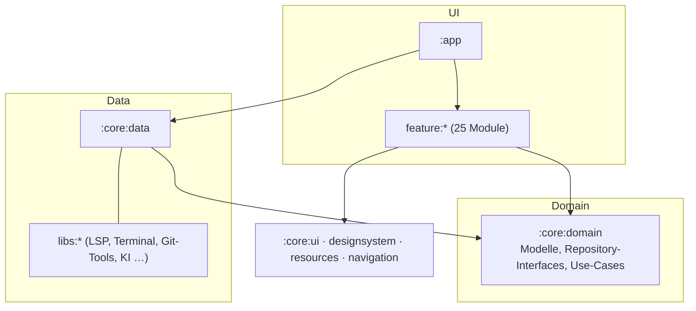

# CodeForge Mobile – Entwicklerhandbuch

> Anwender: [../user/Anwenderhandbuch.md](../user/Anwenderhandbuch.md) · APK: [../apk/APK-Dokumentation.md](../apk/APK-Dokumentation.md) · Modulgraph: [module-graph.md](module-graph.md) · API-Referenz (Dokka): siehe Abschnitt 8

## 1. Voraussetzungen

| Komponente | Version |
|---|---|
| JDK | 21 (Bytecode-Ziel 17) |
| Gradle | 8.14.3 (Wrapper) |
| AGP / Kotlin / KSP | 8.13.2 / 2.1.21 / 2.1.21-2.0.1 |
| Compose BOM | 2025.09.00 |
| `compileSdk` / `minSdk` / `targetSdk` | 36 / 26 / 28 (`targetSdk 28`, damit Termux-Binaries ausführbar bleiben) |

Android-SDK-Plattform 36 und `local.properties` (`sdk.dir=…`) vorhanden. Versionen stehen zentral in `gradle/libs.versions.toml` (Version-Katalog); Build-Logik in `build-logic/convention` (Convention-Plugins `codeforge.*`).

## 2. Architektur

Clean Architecture: **UI (feature) → Domain (core:domain) ← Data (core:data / libs)**. Zustände sind unveränderliche Datenklassen (`@Immutable`), ViewModels liefern `StateFlow`; MVI-Muster mit `UiState`/`UiIntent`/`UiEffect` (z. B. `BuildContract`). Hilt für DI; Feature-Module kennen sich nicht, die App verdrahtet sie über Brücken in `:core:navigation` (`OpenFileRequestBridge`, `FileSyncBridge`, …).



Vollständiger Graph: [module-graph.md](module-graph.md) (erzeugt mit `python3 scripts/gen-module-graph.py`).

### Modulgruppen

| Gruppe | Inhalt |
|---|---|
| `:app` | Einstieg, Navigation (`CodeForgeNavHost`), Workspace-Drawer, Hilt-Wurzel |
| `:core:*` | `common`, `domain`, `data`, `datastore`, `designsystem`, `ui`, `resources` (alle Texte), `navigation`, `testing` |
| `:feature:*` | je ein Bildschirm-/Funktionsbereich (editor, build, git, settings, terminal, plugins, layoutdesigner …) |
| `:libs:*` | technische Bausteine: `lsp-client`, `terminal-engine`, `termux-*` (vendored), `plugin-api/-impl`, `ai-client`, `indexing-*`, `template-engine`, … |
| `:examples:*` | LSP-Beispiel-Plugins (Code-Plugins, Sideload) |

## 3. Bauen und testen

```bash
./gradlew :app:assembleDebug                 # Debug-APK
./gradlew testDebugUnitTest                  # alle Unit-Tests
./gradlew :feature:build:testDebugUnitTest   # ein Modul
./gradlew ktlintCheck                        # Stil (ignoreFailures = true)
```

Bekannte, umgebungsabhängige Tests: `LspFakeServerTest` (Zeitüberschreitung bei knappen Ressourcen). Gradle-Läufe nach längerer Zeit im Hintergrund starten und das Log abfragen.

CI: `.github/workflows/build-debug-apk.yml` (Artefakt) und `release-debug-apk.yml` (getaggtes Pre-release, Tags `debug-*`).

## 4. Strings und UI-Regeln

- Alle sichtbaren Texte in `core/resources/src/main/res/values{,-de}/strings.xml`; Zugriff `stringRes(R.string.x)` (Compose) bzw. `Res.string(…)` (Nicht-UI). Kein Hartcodieren.
- Composables: `modifier: Modifier = Modifier` als erster optionaler Parameter, keine Geschäftslogik, Material 3.
- Neue Strings immer in beiden Sprachen; `&` als `&amp;`.

## 5. Plugin-System

Zwei Arten (Vergleich: [../plugin-modelle-vergleich.md](../plugin-modelle-vergleich.md)):

- **Deklarativ** (`plugin.json` mit `contributes`: Themes, Grammatiken, Snippets, LSP-Server, `requires`) – auch über den Store.
- **Code-Plugin** (`apiVersion 2`, `entryPointClass`, `classes.dex` via `d8`, Berechtigung `shell`) – nur Sideload, geladen per `DexClassLoader`. Schnittstelle: `CodeForgePlugin` (`:libs:plugin-api`).

LSP-Server werden deklarativ über `contributes.lspServers` gestartet; der Resolver (`LspServerResolverImpl.resolveContributed`) ersetzt `${home}` und `${pluginDir}`. Bei mehreren Servern für eine Sprache gewinnt der zuerst gefundene. Beispiele und Packaging: `examples/README.md`, `./gradlew :examples:<modul>:packagePlugin` → `examples/out/<modul>/`.

## 6. LSP-Client (`:libs:lsp-client`)

`LspServerSession` startet den Prozess (stdio), liest stderr (Logcat-Tag `CF-LSP`) und überwacht das Ende; `LspRpcConnection` kapselt JSON-RPC; `LspJsonMapper` wandelt JSON ↔ Domänenmodelle; `LspClientRepositoryImpl` routet je (Server, Workspace). Schreibzugriffe auf einen toten Server fängt `notifySafely` ab (Status `FAILED`). Optionale Anfragen (`foldingRange`, `inlayHint`) liefern ohne Serverunterstützung leere Listen.

## 7. Terminal und Pakete

Termux-Prefix `/data/data/com.codeforge.app/files/usr`. `codeforge-env` (Asset in `:libs:terminal-engine`) installiert JDK/SDK/NDK und große APT-Pakete (`large-packages.txt`, GitHub-Release-Assets, rekursive Abhängigkeiten). Das APT-Repo baut `build-bootstrap-repo.yml`.

## 8. Dokumentation erzeugen

```bash
./gradlew dokkaGenerate                 # API-Referenz aller Module -> build/dokka/html
./gradlew :core:domain:dokkaGeneratePublicationHtml   # ein Modul
python3 scripts/gen-module-graph.py     # Modulgraph neu erzeugen
```

- **KDoc:** öffentliche Klassen, Interfaces, Funktionen und Properties dokumentieren (Zweck, Parameter mit `@param`, Rückgabe, Fehler). Diagramme als ```` ```mermaid ````-Block im KDoc – der Dokka-Mermaid-Plugin rendert sie.
- Dokka und Mermaid stehen im Versionskatalog (`dokka`, `dokkaMermaid`).
- Die Seite (Handbücher + API) veröffentlicht `.github/workflows/docs-pages.yml` auf GitHub Pages.

## 9. Beitragen

1. Branch vom `main`, kleine Commits, Tests ergänzen (JVM-Logik zuerst).
2. `./gradlew testDebugUnitTest ktlintCheck` lokal.
3. `CHANGELOG.md` unter *Unreleased* ergänzen; Strings DE/EN.
4. Lizenz: GPLv3 (siehe `NOTICE.md`).
