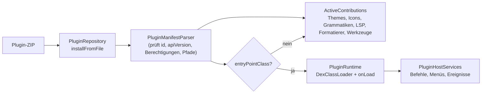
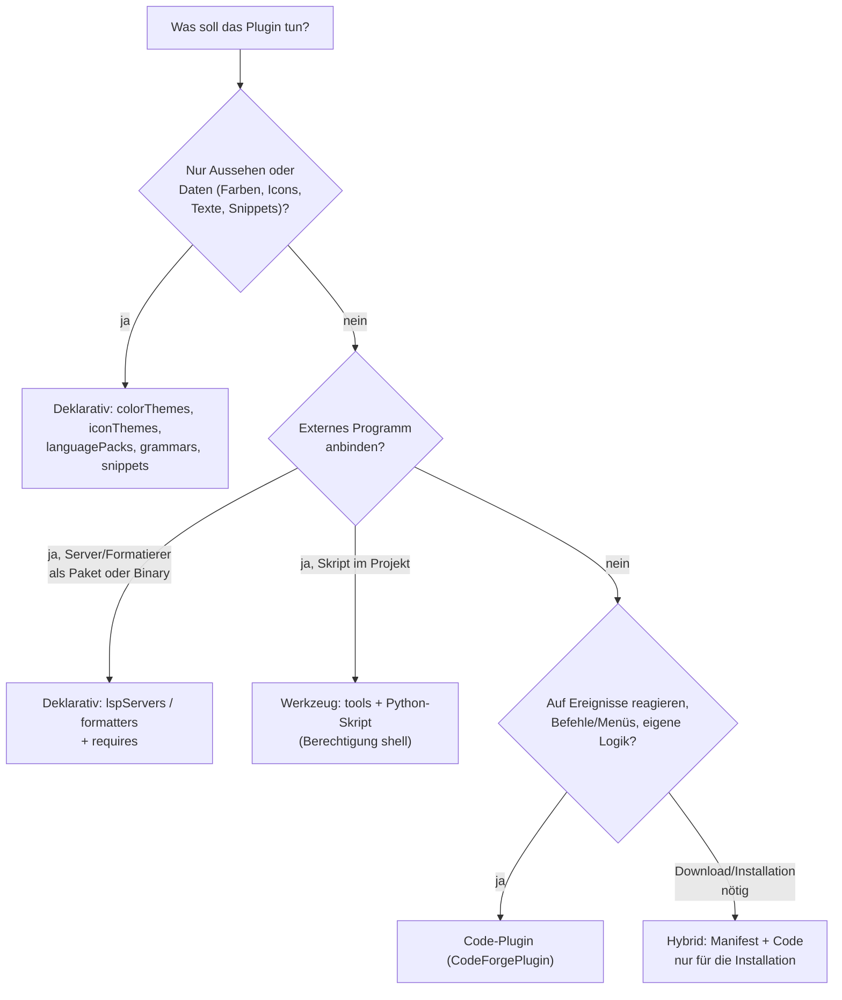
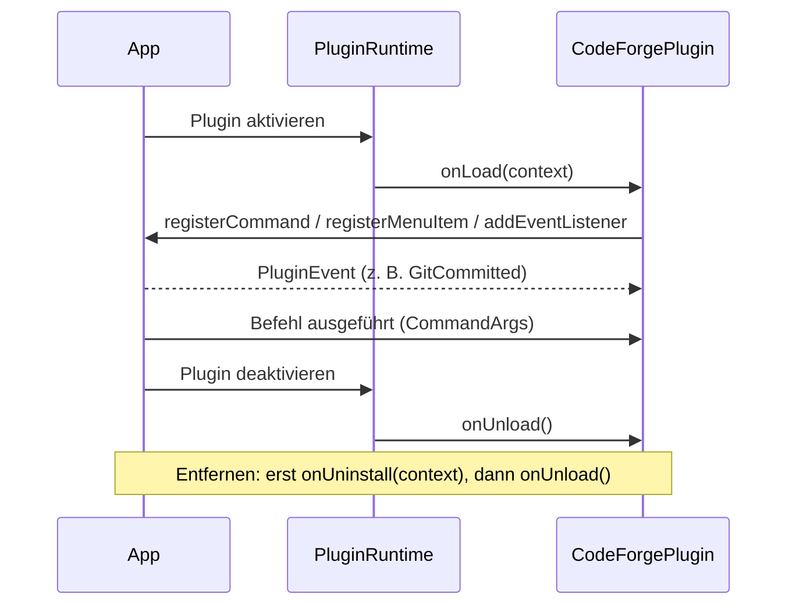

# Plugins entwickeln – von A bis Z

Dieser Leitfaden führt dich durch die komplette Plugin-Entwicklung für CodeForge Mobile: von der Wahl der Plugin-Art über Manifest, Bauen und Testen bis zum Veröffentlichen. Alle Beispiele liegen als lauffähige Quellen im Repository (`examples/guide/`, `templates/`, `examples/`, `tool-plugins/`) und werden von Unit-Tests mit den echten Parsern geprüft (`GuidePluginsValidTest`, `TemplatesValidTest`, `ExamplePluginsValidTest`).

!!! warning "Stand der Prüfung"
    Manifeste, Dateien und Skripte sind im Build und per Unit-Test geprüft, das Code-Plugin ist kompiliert und zu `classes.dex` gepackt. **Auf einem Gerät installiert und ausgeführt** wurde noch nichts davon (offene Punkte: `agy-tasks/61-erweiterungssystem-geraetepruefung.md`). Plane beim ersten echten Test Nacharbeit ein.

Die Feldreferenz zu jedem Beitragstyp steht in [Erweiterungssystem](../extensions.md), der Modellvergleich in [Plugin-Modelle im Vergleich](../plugin-modelle-vergleich.md). Hier geht es um den Weg.

## 1. Überblick

Ein Plugin ist ein **ZIP-Archiv mit `plugin.json` im Wurzelverzeichnis**. Es besteht aus einem oder beiden Teilen:

* **Beiträge** (`contributes`): deklarativ beschriebene Erweiterungen. Die App liest sie direkt aus dem Manifest, es wird kein Code des Plugins geladen.
* **Code** (`entryPointClass` + `classes.dex`): eine Kotlin-Klasse, die `CodeForgePlugin` implementiert und zur Laufzeit per `DexClassLoader` geladen wird.



| Art | Beitrag / Mittel | Code nötig | Store | Beispiel in diesem Leitfaden |
|---|---|---|---|---|
| Farbschema | `colorThemes` | nein | ja (`theme`) | [Nord Night](#5-beispiel-1-farbschema-nord-night) |
| Icon-Paket | `iconThemes` | nein | ja (`icons`) | Vorlage `templates/icon-theme` |
| Sprachpaket | `languagePacks` | nein | ja (`language`) | Vorlage `templates/language-pack` |
| Syntaxfarben | `grammars` | nein | ja (`grammar`) | [Zig](#6-beispiel-2-sprachunterstutzung-zig) |
| Snippets | `snippets` | nein | ja (`snippets`) | [Zig](#6-beispiel-2-sprachunterstutzung-zig) |
| Language Server | `lspServers` (+ `requires`) | nein | ja (`lsp`) | [Zig](#6-beispiel-2-sprachunterstutzung-zig), Pyright |
| Formatierer | `formatters` (+ `requires`) | nein | ja (`formatter`) | [Zig](#6-beispiel-2-sprachunterstutzung-zig), shfmt |
| Bundle | `extensionPack` | nein | ja (`bundle`) | [Bundle](#8-beispiel-4-bundle) |
| Werkzeug im PT-Menü | `tools` + Skript | nein (Skript) | `tool` (mit Bestätigung) | [TODO-Bericht](#7-beispiel-3-werkzeug-todo-bericht) |
| Befehle, Menüs, Ereignisse | `CodeForgePlugin` | ja | nur Sideload | [Commit-Notizen](#9-beispiel-5-code-plugin-commit-notizen) |
| Server installieren / aufräumen | Code + `lspServers` (Hybrid) | ja | nur Sideload | [Hybrid](#10-beispiel-6-hybrid-lsp-plugin-mit-download) |

### Welche Art brauche ich?



**Faustregel:** erst deklarativ. Code nur, wenn sich etwas nicht beschreiben lässt, und dann so klein wie möglich (Hybrid). Deklarative Plugins brauchen kein Android SDK, sind statisch prüfbar und dürfen in den Store.

## 2. Anatomie eines Plugins

### 2.1 Aufbau des Archivs

```text
mein-plugin.zip
├── plugin.json              ← Pflicht, im Wurzelverzeichnis (nicht in einem Unterordner!)
├── themes/…                 ← Dateien, auf die contributes[*].path zeigt (relativ, ohne "..")
├── tool.py                  ← Skripte für tools
└── classes.dex              ← nur bei Code-Plugins (d8-Ausgabe)
```

### 2.2 Felder von `plugin.json`

| Feld | Pflicht | Bedeutung |
|---|---|---|
| `id` | ja | eindeutig, `[A-Za-z0-9][A-Za-z0-9._-]*`, kein `..`; wird zum Verzeichnisnamen. Konvention: umgekehrte Domain, z. B. `com.example.nord` |
| `name` | ja | Anzeigename |
| `version` | ja | Freitext, üblich `MAJOR.MINOR.PATCH` |
| `apiVersion` | nein | `1` (Standard) oder `2`; neu entwickelte Plugins nutzen `2`. Eine neuere als die der App wird abgelehnt |
| `publisher`, `description` | nein | Anzeige im Plugins-Bildschirm |
| `permissions` | nein | Liste aus `commands`, `menus`, `file-events`, `git-events`, `shell`, `lsp`; Unbekanntes lehnt die Installation ab |
| `entryPointClass` | nein | voll qualifizierter Klassenname; macht das Plugin zum Code-Plugin |
| `contributes` | nein | Beiträge, siehe Referenz |

Wichtige Regeln, die der Parser durchsetzt:

* `tools` verlangt die Berechtigung `shell`.
* `colorThemes.uiTheme` muss `dark` oder `light` sein; `lspServers.command` und `.languages` dürfen nicht leer sein; `formatters` brauchen `extensions` oder `fileNames` und `timeoutSeconds` 1..120; `tools.timeoutSeconds` 1..900.
* Option-Werte in `tools.prompt.options` dürfen keine Leerzeichen enthalten und müssen eindeutig sein.
* `requires.manager` ist `pkg`, `npm` oder `pip`; Paketnamen dürfen keine Optionen (`-g`) oder `..` enthalten.
* Alle `path`-Werte sind relativ und ohne `..`.

### 2.3 Platzhalter in Kommandos

| Platzhalter | Gilt in | Wert |
|---|---|---|
| `${pluginDir}` | `lspServers`, `formatters`, `tools` | Verzeichnis des installierten Plugins |
| `${home}` | alle drei | Termux-`$HOME` |
| `${file}`, `${fileName}` | `formatters` | absoluter Pfad bzw. Name der Datei |
| `${projectDir}` | `tools` | Projektordner |
| `${input}` | `tools` | Eingabe aus dem Dialog (`prompt`) |

Kommandos laufen **ohne Shell**: jedes Listenelement ist genau ein Argument. Eine Eingabe kann also keine Befehle einschleusen. Brauchst du Shell-Syntax, rufe sie ausdrücklich auf (`["bash", "-c", "…", "name", "${home}"]`, wie beim XML-Plugin in [Beispiel 6](#10-beispiel-6-hybrid-lsp-plugin-mit-download)).

### 2.4 Berechtigungen

Deklariere nur, was du brauchst. Fehlt eine Berechtigung, wirft der Zugriff `PluginPermissionException` und das Plugin lädt nicht.

| Berechtigung | Wofür | Hinweis |
|---|---|---|
| `commands` | `registerCommand` | |
| `menus` | `registerMenuItem` | |
| `file-events` | `FileOpened`, `FileSaved`, `FileClosed` | |
| `git-events` | `GitCommitted`, `GitBranchChanged` | |
| `shell` | `buildShellCommand`, `tools` | ab `apiVersion` 2 deklarationspflichtig |
| `lsp` | `lspClientRepository` | ab `apiVersion` 2 deklarationspflichtig |

### 2.5 Installation, Ersetzen, Aktivieren

* Sideload: Einstellungen → Plugins → „+“, ZIP wählen. Die App entpackt (mit Zip-Slip-Schutz), validiert und aktiviert das Plugin sofort.
* **Gleiche `id` ersetzt das installierte Plugin vollständig** (altes Verzeichnis wird gelöscht). `version` wird dabei nicht verglichen: Du kannst also jederzeit eine neue Fassung über die alte installieren.
* Lässt sich der Code nicht laden (z. B. fehlendes `classes.dex`), bleibt das Plugin installiert, wird aber nicht geladen. Die Installation gilt trotzdem als erfolgreich: Prüfe, ob der Beitrag bzw. Befehl wirksam ist.
* Deaktivieren (Schalter) ruft `onUnload()`, Entfernen zusätzlich vorher `onUninstall()`.

## 3. Entwicklungsumgebung

| Wofür | Werkzeug |
|---|---|
| Deklarative Plugins bauen | Python 3 (`templates/build.py`), kein SDK |
| Code-Plugins bauen | JDK 17 oder neuer, Android SDK mit `build-tools` (für `d8`), Gradle-Wrapper des Repos |
| Prüfen | `./gradlew :core:domain:testDebugUnitTest` (Parser-Tests) |
| Testen auf dem Gerät | ZIP kopieren, Sideload |

```bash
git clone https://github.com/scto/CodeForgeMobile && cd CodeForgeMobile
export ANDROID_HOME=/pfad/zum/android/sdk        # nur für Code-Plugins
python3 templates/build.py color-theme           # ZIP aus einer Vorlage → templates/build/color-theme.zip (+ SHA-256)
python3 templates/build.py examples/guide/nord-night   # oder aus einem beliebigen Plugin-Ordner
```

`build.py` prüft vorher, dass alle JSON-Dateien gültig sind und alle in `contributes` referenzierten Dateien existieren, und gibt die SHA-256 aus (wird für den Store gebraucht). Ohne Argument baut es alle deklarativen Vorlagen.

Startpunkt für ein neues Plugin: Vorlage kopieren (`cp -r templates/color-theme mein-theme`), `id`, `name`, `version` ändern. Übersicht aller Vorlagen: `templates/README.md`.

## 4. Vorgehen in jedem Projekt

1. **Art wählen** (Abschnitt 1) und passende Vorlage kopieren.
2. **`id` festlegen** und nie mehr ändern: Sie identifiziert das Plugin beim Ersetzen, in Bundles und im Store.
3. **Beiträge bzw. Code schreiben**, Berechtigungen minimal halten.
4. **Statisch prüfen** (`build.py`, Unit-Test).
5. **Auf dem Gerät testen** (Abschnitt 11), Fehler in Abschnitt 14 nachschlagen.
6. **Verteilen**: Sideload oder Store (Abschnitt 12).

## 5. Beispiel 1: Farbschema „Nord Night“

**Ziel:** Ein dunkles Farbschema für die App-Oberfläche (Material-3-Rollen) und den Editor (TextMate-Theme). Nur Dateien, kein Code.

Dateien (`examples/guide/nord-night/`):

```text
plugin.json
themes/nord-night.json            ← Farbrollen der App
themes/syntax/nord-night-tm.json  ← Editor-Syntaxfarben (VS-Code-Theme-Format)
```

**`plugin.json`**

```json
{
  "id": "com.example.guide.nord-night",
  "name": "Nord Night",
  "version": "1.0.0",
  "apiVersion": 2,
  "publisher": "example",
  "description": "Dunkles Nord-Farbschema für App und Editor.",
  "permissions": [],
  "contributes": {
    "colorThemes": [
      { "id": "nord-night", "label": "Nord Night", "uiTheme": "dark", "path": "themes/nord-night.json" }
    ]
  }
}
```

**`themes/nord-night.json`**: Schlüssel sind Material-3-Rollen (vollständige Liste: `ColorThemeFileParser.ROLES`). Nicht genannte Rollen übernimmt die App aus ihrem Standardschema der gewählten Helligkeit (`uiTheme`). Farben als `#RGB`, `#RRGGBB` oder `#AARRGGBB`.

```json
{
  "colors": {
    "primary": "#88C0D0",
    "onPrimary": "#2E3440",
    "primaryContainer": "#3B5A66",
    "onPrimaryContainer": "#D8F0F7",
    "secondary": "#A3BE8C",
    "onSecondary": "#2E3440",
    "tertiary": "#B48EAD",
    "error": "#BF616A",
    "onError": "#2E3440",
    "background": "#2E3440",
    "onBackground": "#ECEFF4",
    "surface": "#3B4252",
    "onSurface": "#ECEFF4",
    "surfaceVariant": "#434C5E",
    "onSurfaceVariant": "#D8DEE9",
    "outline": "#6B7894"
  },
  "textmateTheme": "themes/syntax/nord-night-tm.json"
}
```

Der Pfad `textmateTheme` ist **relativ zum Plugin-Verzeichnis**, nicht zur Theme-Datei.

**`themes/syntax/nord-night-tm.json`**: ein VS-Code-/TextMate-Theme. Der Editor nutzt es, wenn in den Editor-Einstellungen „auto“ gewählt ist.

```json
{
  "name": "Nord Night",
  "type": "dark",
  "colors": { "editor.background": "#2E3440", "editor.foreground": "#D8DEE9" },
  "tokenColors": [
    { "scope": ["comment"], "settings": { "foreground": "#616E88", "fontStyle": "italic" } },
    { "scope": ["string"], "settings": { "foreground": "#A3BE8C" } },
    { "scope": ["keyword", "storage"], "settings": { "foreground": "#81A1C1" } },
    { "scope": ["constant.numeric"], "settings": { "foreground": "#B48EAD" } },
    { "scope": ["entity.name.function"], "settings": { "foreground": "#88C0D0" } }
  ]
}
```

**Bauen und installieren**

```bash
python3 templates/build.py examples/guide/nord-night   # → templates/build/nord-night.zip
```

ZIP aufs Gerät, Einstellungen → Plugins → „+“, dann Einstellungen → Design → „Aus Erweiterungen“ → *Nord Night*. Ist das Plugin später weg oder deaktiviert, fällt die App auf das Standardschema zurück; Dynamic Color hat Vorrang, wenn es aktiviert ist.

**Gestaltungstipps:** Kontrast zwischen `onSurface`/`surface` und `onPrimary`/`primary` prüfen (WCAG 4,5:1 für Text), beide Helligkeiten als zwei `colorThemes`-Einträge anbieten (`uiTheme` `dark` und `light`), `surfaceContainer*`-Rollen für Karten und Menüs setzen, wenn der Standard nicht zum Schema passt.

**Store:** dieses Plugin besteht die Store-Prüfung (rein deklarativ), Kategorie `theme`.

## 6. Beispiel 2: Sprachunterstützung „Zig“

**Ziel:** Eine Sprache, die der Editor nicht kennt, vollständig unterstützen: Syntaxfarben, Snippets, Formatierer, Language Server. Ein Plugin kann mehrere Beitragsarten kombinieren.

```text
examples/guide/zig-support/
├── plugin.json
├── grammars/zig.tmLanguage.json
└── snippets/zig.json
```

**`plugin.json`**

```json
{
  "id": "com.example.guide.zig-support",
  "name": "Zig-Unterstützung",
  "version": "1.0.0",
  "apiVersion": 2,
  "publisher": "example",
  "description": "Syntaxfarben, Snippets, Formatierer (zig fmt) und Language Server (zls) für Zig. Nur per Sideload: zig und zls stehen nicht auf der Store-Freigabeliste.",
  "permissions": [],
  "contributes": {
    "grammars": [
      { "languageId": "zig", "scopeName": "source.zig", "path": "grammars/zig.tmLanguage.json", "extensions": ["zig", "zon"] }
    ],
    "snippets": [
      { "languageId": "zig", "path": "snippets/zig.json" }
    ],
    "formatters": [
      { "id": "zig-fmt", "label": "zig fmt", "extensions": ["zig", "zon"], "command": ["zig", "fmt", "--stdin"], "timeoutSeconds": 20 }
    ],
    "lspServers": [
      { "id": "zls", "label": "ZLS (Zig)", "languages": ["zig"], "command": ["zls"] }
    ],
    "requires": [
      { "manager": "pkg", "name": "zig", "check": "zig" },
      { "manager": "pkg", "name": "zls", "check": "zls" }
    ]
  }
}
```

Was die einzelnen Beiträge tun:

* **`grammars`**: TextMate-Grammatik. Die Zuordnung läuft über die Dateiendung (ohne Punkt) oder einen exakten Dateinamen. Sie gilt nur für Dateitypen **ohne eingebaute Grammatik** (eingebaut: Kotlin, Java, XML, JSON). Sie liefert nur Syntaxfarben, keine Klammerpaare oder Kommentarzeichen.
* **`snippets`**: VS-Code-Format, `languageId` bestimmt den Geltungsbereich. Erscheinen in der Auto-Vervollständigung, sind dort schreibgeschützt.
* **`formatters`**: Der Editor schreibt den Dateiinhalt auf **stdin** des Kommandos und ersetzt ihn durch **stdout**. Exit-Code ≠ 0 ist ein Fehler (erste stderr-Zeile wird angezeigt). Reihenfolge beim Formatieren: Plugin-Formatierer → LSP → ktlint/google-java-format → eingebauter Formatierer. Bereichsformatierung (Auswahl) unterstützen Plugin-Formatierer nicht.
* **`lspServers`**: Die App startet den Server bei Bedarf mit dem **aktiven Projekt als Workspace**. Ein in der App installierter Server (Extensions-Manager) hat Vorrang vor Plugin-Servern.
* **`requires`**: Programme, die vorhanden sein müssen. Die App prüft das und bietet die Installation an, aber **nie automatisch**: der Plugins-Bildschirm zeigt „Fehlende Programme“ und installiert erst nach Bestätigung (Live-Ausgabe, abbrechbar).

**`grammars/zig.tmLanguage.json`**: Jedes Muster hat einen TextMate-Bereichsnamen (`name`). Der Editor färbt sie über das aktive Theme (Beispiel [Nord Night](#5-beispiel-1-farbschema-nord-night)): `comment.*`, `string.*`, `constant.numeric.*`, `keyword.*`, `storage.*`.

```json
{
  "scopeName": "source.zig",
  "name": "Zig",
  "patterns": [
    { "name": "comment.line.double-slash.zig", "match": "//.*$" },
    { "name": "string.quoted.double.zig", "begin": "\"", "end": "\"",
      "patterns": [ { "name": "constant.character.escape.zig", "match": "\\\\." } ] },
    { "name": "constant.numeric.zig", "match": "\\b(0x[0-9A-Fa-f_]+|[0-9][0-9_]*(\\.[0-9_]+)?)\\b" },
    { "name": "storage.type.zig", "match": "\\b(const|var|fn|pub|struct|enum|union|error|comptime|test)\\b" },
    { "name": "keyword.control.zig", "match": "\\b(if|else|while|for|switch|return|try|catch|defer|errdefer|break|continue|orelse)\\b" },
    { "name": "support.function.builtin.zig", "match": "@[A-Za-z_][A-Za-z0-9_]*" }
  ]
}
```

**`snippets/zig.json`**: `${1:name}` sind Tabstopps mit Vorgabe, `$0` ist die Endposition des Cursors.

```json
{
  "Main": {
    "prefix": "main",
    "body": [
      "const std = @import(\"std\");",
      "",
      "pub fn main() !void {",
      "    $0",
      "}"
    ],
    "description": "Programmeinstieg"
  },
  "Print": {
    "prefix": "print",
    "body": "std.debug.print(\"${1:text}\\n\", .{$2});",
    "description": "Debug-Ausgabe"
  },
  "Test": {
    "prefix": "test",
    "body": [
      "test \"${1:name}\" {",
      "    try std.testing.expectEqual(@as(i32, ${2:1}), ${3:1});",
      "}"
    ],
    "description": "Testfall"
  }
}
```

!!! note "Store-Grenze"
    `zig` und `zls` stehen **nicht** auf der Store-Freigabeliste für `requires` (siehe [Abschnitt 12](#12-verteilen-sideload-oder-store)). Dieses Plugin ist deshalb nur per Sideload installierbar; der Store lehnt es mit „Voraussetzung nicht auf der Freigabeliste“ ab (`GuidePluginsValidTest` hält das fest). Für den Store müssen die Programme auf der Liste stehen (z. B. `shfmt`, `taplo`, `pyright`) oder der Nutzer installiert sie selbst.

**Teilen in mehrere Plugins:** Für den Store sind kleine Plugins mit einem Zweck üblich (`….lsp`, `….formatter`), die ein [Bundle](#8-beispiel-4-bundle) zusammenfasst. So können Nutzer nur den Formatierer installieren. Fertige Beispiele: `tool-plugins/src/com.codeforge.plugin.shfmt.formatter` und `…pyright.lsp`.

**Statisch testen:** `python3 templates/build.py examples/guide/zig-support`. Auf dem Gerät eine `.zig`-Datei öffnen: Syntaxfarben erscheinen beim ersten Öffnen; lässt sich die Grammatik nicht laden, bleibt der Editor bei Klartext.

## 7. Beispiel 3: Werkzeug „TODO-Bericht“

**Ziel:** Ein Eintrag im **PT-Menü** des Dateibaums, der ein Python-Skript im Projektordner ausführt und die Ausgabe live anzeigt. Werkzeuge sind der einfachste Weg, eigene Automatisierung hinzuzufügen, ohne Kotlin.

```text
examples/guide/todo-report/
├── plugin.json
└── tool.py
```

**`plugin.json`**: `permissions: ["shell"]` ist Pflicht für `tools`. Das `prompt` zeigt ein Dropdown (`options`) statt eines Textfelds; das Werkzeug erhält den gewählten Wert als `${input}`. `requires` stellt Python sicher.

```json
{
  "id": "com.example.guide.todo-report.tool",
  "name": "TODO-Bericht (Werkzeug)",
  "version": "1.0.0",
  "apiVersion": 2,
  "publisher": "example",
  "description": "Listet TODO-, FIXME- und HACK-Marker eines Projekts im PT-Menü des Dateibaums auf. Führt ein Skript aus (Berechtigung shell).",
  "permissions": ["shell"],
  "contributes": {
    "tools": [
      {
        "id": "report",
        "label": "TODO-Bericht",
        "description": "Sucht Marker in Quelltexten",
        "command": ["python3", "${pluginDir}/tool.py", "${projectDir}", "${input}"],
        "timeoutSeconds": 60,
        "prompt": {
          "label": "Marker",
          "default": "all",
          "options": [
            { "value": "all", "label": "Alle" },
            { "value": "todo", "label": "Nur TODO" },
            { "value": "fixme", "label": "Nur FIXME" },
            { "value": "hack", "label": "Nur HACK" }
          ]
        }
      }
    ],
    "requires": [
      { "manager": "pkg", "name": "python", "check": "python3" }
    ]
  }
}
```

**`tool.py`**: Konvention der mitgelieferten Werkzeuge: `argv[1]` = Projektordner, `argv[2]` = Eingabe. Alles, was auf stdout/stderr steht, erscheint live im Dialog. Ein Exit-Code ≠ 0 gilt als Fehlschlag.

```python
#!/usr/bin/env python3
"""TODO-Bericht: sucht TODO/FIXME/HACK in Quelltexten. Aufruf: tool.py <projektordner> [all|todo|fixme|hack]"""
import os, re, sys

SKIP_DIRS = {"build", ".git", ".gradle", ".idea", "node_modules", ".kotlin", ".cxx", ".cfm", "__pycache__"}
TEXT_EXTS = {"kt", "kts", "java", "xml", "py", "js", "ts", "rs", "go", "c", "cpp", "h", "md", "sh", "zig", "toml", "yaml", "yml"}
MARKERS = ("TODO", "FIXME", "HACK")


def main():
    project = os.path.abspath(sys.argv[1]) if len(sys.argv) > 1 else os.getcwd()
    mode = (sys.argv[2].strip().lower() if len(sys.argv) > 2 and sys.argv[2].strip() else "all")
    wanted = MARKERS if mode == "all" else tuple(m for m in MARKERS if m.lower() == mode)
    if not wanted:
        raise SystemExit(f"Unbekannter Modus '{mode}'. Erlaubt: all, todo, fixme, hack")
    pattern = re.compile(r"\b(" + "|".join(wanted) + r")\b[:\s-]*(.*)")
    hits = 0
    for d, dirs, files in os.walk(project):
        dirs[:] = sorted(x for x in dirs if x not in SKIP_DIRS)
        for f in sorted(files):
            if f.rsplit(".", 1)[-1].lower() not in TEXT_EXTS:
                continue
            path = os.path.join(d, f)
            try:
                with open(path, encoding="utf-8", errors="replace") as fh:
                    for no, line in enumerate(fh, 1):
                        m = pattern.search(line)
                        if m:
                            hits += 1
                            print(f"{os.path.relpath(path, project)}:{no}  [{m.group(1)}] {m.group(2).strip()[:100]}")
            except OSError as e:
                print(f"{path}: {e}", file=sys.stderr)
    print(f"\n{hits} Treffer ({', '.join(wanted)})")


main()
```

Ablauf in der App: PT-Dropdown im Kopf des Dateibaums → „TODO-Bericht“ → Dialog mit Auswahl → die App prüft `requires` → startet `python3 …/tool.py <Projekt> <Auswahl>` im Projektordner → Ausgabe live im Dialog → Dateibaum wird aktualisiert.

**Das Skript lokal testen** (kein Gerät nötig):

```bash
python3 examples/guide/todo-report/tool.py /pfad/zum/projekt fixme
```

**Gute Werkzeug-Praxis**

* Eine Aktion mit Änderungen (Dateien umschreiben, löschen) bekommt zuerst einen **Prüfmodus** (`check`) und erst dann `apply`; `confirm` zeigt vor dem Start einen Hinweis („Bitte vorher committen“). Vorbild: `tool-plugins/scripts/androidx_migrate.py`, `project_clean.py`.
* Build-Ordner überspringen (`build`, `.git`, `.gradle`, `node_modules`, `.cfm` …): Die mitgelieferten Skripte teilen sich dafür `tool-plugins/scripts/common.py`.
* `timeoutSeconds` realistisch setzen (1..900, Standard 120).
* Kein Zugriff über das Projekt hinaus: Das Werkzeug läuft mit den Rechten der App, aber nur im Projektordner als Arbeitsverzeichnis.
* Über `.sh` kann ein Plugin nicht ausgeliefert werden (der Store lehnt es ab); nimm Python.

**Verteilen:** Per Sideload oder in der Store-Kategorie `tool` („Code-Tools“): Dort erlaubt die App `tools` und Skripte wie `.py`, lehnt aber weiter `entryPointClass`, `.dex/.jar/.so/.apk/.class/.aar` und `.sh` ab und fragt vor der Installation nach Bestätigung.

## 8. Beispiel 4: Bundle

**Ziel:** Mehrere Plugins als ein Paket installieren, z. B. „Zig komplett“.

```json
{
  "id": "com.example.guide.zig-pack",
  "name": "Zig komplett",
  "version": "1.0.0",
  "apiVersion": 2,
  "publisher": "example",
  "description": "Farbschema und Sprachunterstützung für Zig.",
  "permissions": [],
  "contributes": {
    "extensionPack": [
      "com.example.guide.nord-night",
      "com.example.guide.zig-support"
    ]
  }
}
```

* Ein Bundle hat keine eigenen Beiträge; es nennt die `id`s der Mitglieder.
* Beim Installieren **aus dem Store** werden fehlende Mitglieder aus dem Katalog mitinstalliert (verschachtelte Bundles bis Tiefe 4, ohne Zyklen). Deshalb müssen alle Mitglieder im Katalog stehen.
* Per Sideload installiert man die Mitglieder einzeln; `ExtensionPacks.missingMembers` zeigt, was fehlt.
* Fertige Beispiele: `tool-plugins/src/com.codeforge.plugin.all-formatters.bundle` und `…all-lsp-servers.bundle`.

## 9. Beispiel 5: Code-Plugin „Commit-Notizen“

**Ziel:** Ein Plugin mit Verhalten: Es hört auf Git-Commits, protokolliert sie in einer Datei und zeigt die letzten Einträge über einen Befehl im Editor-Menü. Das geht nicht deklarativ.

```text
examples/guide/commit-notes/
├── plugin.json
├── build.gradle.kts
└── src/main/kotlin/com/example/codeforgeplugin/commitnotes/CommitNotesPlugin.kt
```

### 9.1 Die API in Kürze



| Element | Aufgabe |
|---|---|
| `CodeForgePlugin.onLoad(context)` | beim Laden/Aktivieren: Befehle, Menüs, Listener registrieren |
| `onUnload()` | Arbeit beenden, Coroutinen abbrechen |
| `onUninstall(context)` (`suspend`) | nur beim Entfernen: selbst angelegte Dateien außerhalb des Plugin-Ordners löschen |
| `context.hostServices.registerCommand(id, title) { args -> … }` | Befehl (`commands`); `args.activeFilePath` = aktive/gewählte Datei oder `null` |
| `registerMenuItem(id, title, target, commandId)` | Menüeintrag (`menus`); Ziel `EDITOR_MENU` oder `FILE_CONTEXT_MENU` |
| `addEventListener { event -> … }` | Ereignisse (`file-events`, `git-events`) |
| `showMessage(text)` | kurze Meldung (max. 500 Zeichen), keine Berechtigung nötig |
| `homeDir`, `jdkInstallPath(v)`, `buildShellCommand(…)` | Umgebung; `buildShellCommand` braucht `shell` |

Grenzen: höchstens 100 Befehle/Menüeinträge je Plugin, Titel ≤ 120 Zeichen, ein Befehl wird nach 60 s abgebrochen. Beim Deaktivieren, Entfernen oder wenn `onLoad` fehlschlägt, entfernt die App alle Registrierungen des Plugins.

### 9.2 Manifest

```json
{
  "id": "com.example.guide.commit-notes",
  "name": "Commit-Notizen",
  "version": "1.0.0",
  "apiVersion": 2,
  "publisher": "example",
  "description": "Protokolliert Git-Commits in einer Logdatei und zeigt die letzten Einträge über einen Editor-Befehl an (nur per Sideload).",
  "permissions": ["commands", "menus", "git-events"],
  "entryPointClass": "com.example.codeforgeplugin.commitnotes.CommitNotesPlugin"
}
```

Es werden genau die benötigten Berechtigungen deklariert (`GuidePluginsValidTest` prüft das). Es gibt kein `contributes`: Alles passiert im Code. `entryPointClass` benennt die Klasse mit No-Arg-Konstruktor.

### 9.3 Code

```kotlin
/**
 * Modul: :examples:guide-commit-notes
 * @author Thomas Schmid
 *
 * Beispiel-Code-Plugin (API v2): hört auf Git-Commits, schreibt sie in `$HOME/.codeforge-commit-notes.log` und
 * zeigt die letzten Einträge über einen Befehl im Editor-Menü an. Berechtigungen: `commands`, `menus`, `git-events`.
 */
package com.example.codeforgeplugin.commitnotes

import com.codeforge.libs.plugin_api.CodeForgePlugin
import com.codeforge.libs.plugin_api.PluginContext
import com.codeforge.libs.plugin_api.PluginEvent
import com.codeforge.libs.plugin_api.PluginHostServices
import com.codeforge.libs.plugin_api.PluginMenuTarget
import kotlinx.coroutines.Dispatchers
import kotlinx.coroutines.withContext
import java.io.File
import java.time.LocalDateTime
import java.time.format.DateTimeFormatter

/** Protokolliert Commits und zeigt die letzten [SHOWN] Einträge an. */
class CommitNotesPlugin : CodeForgePlugin {

    private val lock = Any()
    private lateinit var logFile: File

    override fun onLoad(context: PluginContext) {
        val host: PluginHostServices = context.hostServices
        logFile = File(host.homeDir, LOG_NAME)

        host.registerCommand(COMMAND_ID, "Letzte Commits anzeigen") {
            val lines = withContext(Dispatchers.IO) { lastEntries() }
            host.showMessage(if (lines.isEmpty()) "Noch keine Commits protokolliert." else lines.joinToString("\n"))
        }
        host.registerMenuItem("commit-notes-menu", "Letzte Commits", PluginMenuTarget.EDITOR_MENU, COMMAND_ID)

        host.addEventListener { event ->
            if (event is PluginEvent.GitCommitted) append(event)
        }
    }

    override fun onUnload() = Unit

    /** Beim vollständigen Entfernen die selbst angelegte Logdatei löschen (nicht beim bloßen Deaktivieren). */
    override suspend fun onUninstall(context: PluginContext) {
        withContext(Dispatchers.IO) { File(context.hostServices.homeDir, LOG_NAME).delete() }
    }

    private fun append(event: PluginEvent.GitCommitted) {
        val time = LocalDateTime.now().format(DateTimeFormatter.ofPattern("yyyy-MM-dd HH:mm"))
        val message = event.message.lineSequence().firstOrNull().orEmpty().take(MAX_MESSAGE)
        val line = "$time  ${File(event.repoPath).name}: $message"
        synchronized(lock) { logFile.appendText(line + "\n") }
    }

    private fun lastEntries(): List<String> = synchronized(lock) {
        if (!logFile.isFile) emptyList() else logFile.readLines().takeLast(SHOWN)
    }

    private companion object {
        const val LOG_NAME = ".codeforge-commit-notes.log"
        const val COMMAND_ID = "show-commits"
        const val SHOWN = 5
        const val MAX_MESSAGE = 80
    }
}
```

Was hier mit Absicht so gemacht ist:

* **Listener sind nicht auf dem UI-Thread garantiert** und können gleichzeitig laufen: der Dateizugriff ist mit `synchronized` geschützt. Ein werfender Listener stört weder andere Plugins noch die App, sollte aber nichts verschlucken, was der Nutzer wissen muss.
* Der Befehlshandler ist `suspend`: Dateizugriff wechselt mit `withContext(Dispatchers.IO)` auf den IO-Dispatcher.
* `onUninstall` räumt nur Selbstangelegtes auf, und **nur dort**: bei bloßem Deaktivieren bleibt die Logdatei bestehen.
* Zustand liegt unter `homeDir` (Termux-`$HOME`), nicht im Plugin-Verzeichnis: Das Plugin-Verzeichnis wird beim Ersetzen durch eine neue Fassung vollständig gelöscht.
* Kein Zugriff auf App-Internas: Alles läuft über `PluginHostServices`. Das ist bewusst eine kleine Fassade (Sandbox-Prinzip).

### 9.4 Build-Datei

```kotlin
plugins {
    alias(libs.plugins.codeforge.kotlin.library)
    alias(libs.plugins.codeforge.quality)
}

// compileOnly: SDK und Coroutines sind zur Laufzeit im Host-Prozess vorhanden (Parent-Delegation in PluginRuntime).
dependencies {
    compileOnly(project(":libs:plugin-api"))
    compileOnly(libs.kotlinx.coroutines.core)
}

// Kein Toolchain-Zwang (läuft auch mit JDK 21): Bytecode-Ziel 17, d8 entzuckert für Android.
kotlin {
    compilerOptions { jvmTarget.set(org.jetbrains.kotlin.gradle.dsl.JvmTarget.JVM_17) }
}
java {
    sourceCompatibility = JavaVersion.VERSION_17
    targetCompatibility = JavaVersion.VERSION_17
}

/** Konvertiert die .class-Dateien via `d8` zu classes.dex (benötigt ANDROID_HOME mit build-tools). */
val dexClasses by tasks.registering(Exec::class) {
    dependsOn("compileKotlin")

    val androidHome = System.getenv("ANDROID_HOME") ?: System.getenv("ANDROID_SDK_ROOT")
    val ownClassesDir = layout.buildDirectory.dir("classes/kotlin/main")
    val dexOutputDir = layout.buildDirectory.dir("dex")

    doFirst {
        requireNotNull(androidHome) { "ANDROID_HOME oder ANDROID_SDK_ROOT muss gesetzt sein." }
        dexOutputDir.get().asFile.mkdirs()

        val buildToolsRoot = file("$androidHome/build-tools")
        val latestBuildTools = buildToolsRoot.listFiles()?.maxByOrNull { it.name }
            ?: error("Keine Build-Tools unter $buildToolsRoot gefunden.")
        val d8Binary = File(latestBuildTools, "d8")
        check(d8Binary.isFile) { "d8 nicht gefunden unter ${d8Binary.path}" }

        val classFiles = fileTree(ownClassesDir).matching { include("**/*.class") }.files
        check(classFiles.isNotEmpty()) { "Keine .class-Dateien gefunden — vorher compileKotlin ausführen." }

        commandLine(
            listOf(d8Binary.absolutePath, "--output", dexOutputDir.get().asFile.absolutePath) +
                classFiles.map { it.absolutePath }
        )
    }
}

val packagePlugin by tasks.registering(Zip::class) {
    dependsOn(dexClasses)
    archiveFileName.set("commit-notes-plugin.zip")
    destinationDirectory.set(layout.buildDirectory.dir("plugin-package"))

    from(projectDir) { include("plugin.json") }
    from(layout.buildDirectory.dir("dex")) { include("classes.dex") }
}
```

* `compileOnly`: SDK (`:libs:plugin-api`) und Coroutines liegen zur Laufzeit im App-Prozess (Parent-Delegation im `DexClassLoader`). Nichts davon darf ins `classes.dex`, sonst gibt es doppelte Klassen.
* `d8` wandelt die `.class`-Dateien in `classes.dex` um; `DexClassLoader` lädt **keine** rohen `.class`-/`.jar`-Dateien.
* `packagePlugin` packt `plugin.json` und `classes.dex` als ZIP; das ZIP enthält also **nur** diese zwei Dateien im Wurzelverzeichnis.
* Der Bytecode zielt auf Java 17 (`jvmTarget`), die Toolchain ist nicht erzwungen, damit es auch mit einem neueren JDK baut.

### 9.5 Bauen, installieren, ausprobieren

```bash
export ANDROID_HOME=/pfad/zum/android/sdk
./gradlew :examples:guide-commit-notes:packagePlugin
# → examples/guide/commit-notes/build/plugin-package/commit-notes-plugin.zip
```

Sideload (Einstellungen → Plugins → „+“, aktivieren). Dann in einem Git-Projekt committen und über die Plugin-Schaltfläche der Editor-Leiste „Letzte Commits“ wählen. Auf dem Gerät noch nicht geprüft.

### 9.6 Eigenes Code-Plugin anlegen

1. `templates/code-plugin` (oder dieses Beispiel) kopieren.
2. In `settings.gradle.kts` das Modul eintragen (bei Vorlagen: `:templates:code-plugin`, hier `:examples:guide-commit-notes` mit `projectDir`).
3. `id`, `entryPointClass` und Paketnamen ändern, Berechtigungen auf das Nötige reduzieren.
4. Bauen wie oben.

!!! tip "Typische Muster"
    * **Beim Speichern reagieren:** `PluginEvent.FileSaved(path)` mit `file-events`, dann z. B. eine Prüfung starten.
    * **Dateibaum-Kontextmenü:** `registerMenuItem(…, PluginMenuTarget.FILE_CONTEXT_MENU, id)`; der Befehl erhält den gewählten Pfad in `args.activeFilePath`.
    * **Programm ausführen:** `buildShellCommand(script, workingDirectory)` liefert ein `ShellLaunchSpec` (Befehl + Umgebung mit `PREFIX`, `HOME`, `PATH`); `spec.processEnv` muss auf `ProcessBuilder(...).environment()` angewendet werden. Berechtigung `shell`.
    * **Langlaufende Arbeit:** eigener `CoroutineScope(SupervisorJob() + Dispatchers.IO)`, in `onUnload()` mit `cancel()` beenden.

## 10. Beispiel 6: Hybrid – LSP-Plugin mit Download

**Ziel:** Ein Language Server, der nicht als Paket vorliegt, sondern heruntergeladen werden muss. Das Manifest startet den Server (deklarativ), der Code stellt nur sicher, dass er da ist.

Das ist das Muster der acht LSP-Beispiele in `examples/` (Kotlin, Java, XML, C/C++, Bash, YAML, TOML, Python) und des kmp-lsp-Plugins. Die gemeinsame Basis `LspServerPlugin` (Modul `:examples:lsp-plugin-common`) erledigt Prüfen, Installieren, Meldungen und Aufräumen. Ein Plugin besteht aus einer Spezifikation:

```kotlin
/**
 * Modul: :examples:xml-lsp-plugin
 * @author Thomas Schmid
 *
 * XML Language Server (LemMinX) — neues Plugin-Modell (apiVersion 2): Start des Servers erfolgt deklarativ über
 * `contributes.lspServers` in plugin.json; diese Klasse stellt nur sicher, dass der Server vorhanden ist.
 */
package com.example.codeforgeplugin.xmllsp

import com.example.codeforgeplugin.lspcommon.LspServerPlugin
import com.example.codeforgeplugin.lspcommon.LspServerSpec
import com.example.codeforgeplugin.lspcommon.ServerDownload

class XmlLspPlugin : LspServerPlugin(
    LspServerSpec(
        tag = "XmlLspPlugin",
        displayName = "XML Language Server (LemMinX)",
        installDir = "\$HOME/.local/share/lemminx",
        installedCheck = "test -s \$HOME/.local/share/lemminx/org.eclipse.lemminx-uber.jar",
        download = ServerDownload(
            "https://repo.eclipse.org/content/repositories/lemminx-releases/org/eclipse/lemminx/org.eclipse.lemminx/0.28.0/org.eclipse.lemminx-0.28.0-uber.jar",
            fileName = "org.eclipse.lemminx-uber.jar"
        ),
        requiredJdk = "17"
    )
)
```

und einem Manifest, das den Start beschreibt:

```json
{
  "id": "com.example.xml-lsp",
  "name": "XML Language Server (LemMinX)",
  "version": "2.0.0",
  "apiVersion": 2,
  "publisher": "example",
  "description": "Lädt Eclipse LemMinX (Uber-JAR 0.28.0) nach ~/.local/share und bindet ihn für XML ein. Benötigt JDK 17.",
  "permissions": [
    "shell"
  ],
  "entryPointClass": "com.example.codeforgeplugin.xmllsp.XmlLspPlugin",
  "contributes": {
    "lspServers": [
      {
        "id": "lemminx",
        "label": "Eclipse LemMinX (XML)",
        "languages": [
          "xml"
        ],
        "command": [
          "bash",
          "-c",
          "exec \"$PREFIX/lib/jvm/java-17-openjdk/bin/java\" -jar \"$1/.local/share/lemminx/org.eclipse.lemminx-uber.jar\"",
          "xml-lsp",
          "${home}"
        ]
      }
    ]
  }
}
```

Beobachte:

* `contributes.lspServers[].command` startet den Server über `bash -c`; `${home}` wird als `$1` übergeben, weil Kommandos ohne Shell laufen.
* Der Plugin-Code startet den Server **nicht**: Das macht der `LspServerResolver` der App, mit dem aktiven Projekt als Workspace. So kollidieren mehrere Plugins nicht.
* `LspServerSpec` kennt drei Beschaffungswege: `download` (`.tar.gz` entpacken oder Einzeldatei), `installScript` (eigenes Skript) oder `missingHint` (nur Hinweis).
* Vor dem Start wird mit `requiredJdk` geprüft, ob das JDK vorhanden ist; sonst meldet das Plugin, es im SDK-Manager zu installieren. Das JDK wird beim Entfernen **nicht** gelöscht, es gehört dem SDK-Manager.
* `onUninstall` löscht nur `installDir`.

**Eigener Download mit Prüfsumme:** Das kmp-lsp-Plugin zeigt, wie ein `installScript` ein Binary lädt und die **SHA-256 vor dem Entpacken prüft** (bei Abweichung wird nichts installiert). Das solltest du für jeden Download übernehmen; siehe `examples/kmp-lsp-plugin/src/main/kotlin/…/KmpLspPlugin.kt`.

**Wann Hybrid, wann deklarativ?** Liegt der Server als Termux-/npm-/pip-Paket vor (clangd, Pyright, Taplo …), reicht `requires` ohne Code. Hybrid brauchst du nur für Download, Entpacken, Patchen oder Aufräumen. Mehr dazu: [Plugin-Modelle im Vergleich](../plugin-modelle-vergleich.md).

## 11. Testen

### 11.1 Statisch (ohne Gerät)

| Was | Wie |
|---|---|
| JSON gültig, referenzierte Dateien vorhanden | `python3 templates/build.py <ordner>` |
| Manifest mit dem echten Parser | Unit-Test nach dem Muster von `GuidePluginsValidTest` (`PluginManifestParser.parse(...)`, `ColorThemeFileParser`, `DeclarativeOnly.violation(...)`) |
| Skripte | direkt aufrufen (`python3 tool.py <ordner> <eingabe>`) auf einem Beispielprojekt |
| Code kompiliert, `classes.dex` entsteht | `./gradlew :…:packagePlugin` |

```bash
./gradlew :core:domain:testDebugUnitTest --tests "*GuidePluginsValidTest*" --tests "*TemplatesValidTest*"
```

### 11.2 Auf dem Gerät

1. ZIP aufs Gerät, Einstellungen → Plugins → „+“.
2. Im Plugins-Bildschirm prüfen, dass das Plugin aktiviert ist und der Beitrag bzw. Befehl wirksam ist (ein Code-Plugin kann installiert, aber nicht geladen sein); bei `requires` die Meldung „Fehlende Programme“ bestätigen.
3. Beitrag nutzen (Design wählen, PT-Menü öffnen, Datei formatieren, Befehl ausführen).
4. Deaktivieren und wieder aktivieren: Beitrag verschwindet und kommt zurück.
5. Entfernen: `onUninstall` aufgeräumt? Reste unter `$HOME`?
6. Neu installieren (gleiche `id`) und prüfen, dass die alte Fassung vollständig ersetzt ist.

### 11.3 Checkliste vor dem Verteilen

* [ ] `id` eindeutig und endgültig, `version` erhöht
* [ ] `apiVersion` 2, nur benötigte `permissions`
* [ ] alle Pfade relativ, `plugin.json` im ZIP-Wurzelverzeichnis
* [ ] Kontrast des Farbschemas geprüft (hell/dunkel)
* [ ] Werkzeuge: Prüfmodus vor Änderungsmodus, sinnvolle `timeoutSeconds`
* [ ] Downloads per HTTPS, mit SHA-256-Prüfung
* [ ] Code-Plugin: Zustand unter `homeDir`, Aufräumen nur in `onUninstall`, Listener thread-sicher
* [ ] Auf einem echten Gerät mindestens einmal installiert und ausprobiert

## 12. Verteilen: Sideload oder Store

| | Sideload | Store |
|---|---|---|
| Inhalt | alles, auch Code-Plugins und `tools` | nur deklarative Kategorien; Werkzeuge in `tool` |
| Prüfung | Manifest-Parser | zusätzlich `DeclarativeOnly` (kein Code), SHA-256, `requires`-Freigabeliste |
| Wege | ZIP per Datei teilen | Eintrag in `store.json` |

**Store-Regeln** (`DeclarativeOnly`, `RequirementPolicy`): Das Archiv darf nicht enthalten: `entryPointClass`, `.dex`, `.jar`, `.so`, `.apk`, `.class`, `.aar`, `.sh`; es braucht mindestens einen Beitrag; `requires` nur mit freigegebenen Paketen:

| Manager | Freigegeben |
|---|---|
| `pkg` | clang, cmake, nodejs, python, golang, rust, rust-analyzer, ruff, shfmt, shellcheck, taplo, gopls, dart, neocmakelsp, ktlint, git, jq, ripgrep, librsvg |
| `npm` | prettier, typescript, typescript-language-server, pyright, bash-language-server, vscode-langservers-extracted, yaml-language-server |
| `pip` | (keine) |

**Veröffentlichen in vier Schritten**

1. ZIP bauen: `python3 templates/build.py <ordner>`; die ausgegebene SHA-256 notieren.
2. ZIP per **HTTPS** hosten, z. B. als GitHub-Release-Asset.
3. Eintrag in `store.json` des Katalog-Repositories (`scto/codeforge-store`, Vorlage `store-site/store.json`) ergänzen:

```json
{ "id": "com.example.guide.nord-night", "category": "theme",
  "name": { "de": "Nord Night", "en": "Nord Night" },
  "summary": { "de": "Dunkles Nord-Farbschema", "en": "Dark Nord colors" },
  "version": "1.0.0", "author": "example",
  "downloadUrl": "https://github.com/example/nord-night/releases/download/v1.0.0/nord-night.zip",
  "sha256": "<64 Hex-Zeichen>", "homepage": "https://github.com/example/nord-night" }
```

4. Committen und pushen; die zentrale Seite zeigt den Katalog sofort ([Store](../store.md)), die App lädt ihn beim nächsten Öffnen.

Pflichtfelder pro Eintrag: `id` (= `id` aus `plugin.json`), `category`, `name`. Ein Eintrag ohne eines dieser Felder wird ignoriert; nur `http(s)`-Links werden übernommen. Kategorien: `theme`, `icons`, `language`, `grammar`, `snippets`, `lsp`, `formatter`, `bundle`, `tool`, `plugin` (Sideload-Hinweis). Ist `sha256` angegeben, prüft die App den Download dagegen, bevor sie installiert; trage sie deshalb immer ein (im Katalogformat ist sie optional).

Mit `python3 store-site/publish.py <checkout-von-codeforge-store>` baut das Repository alle eigenen Plugin-Pakete und schreibt Katalog und Archive neu (nur für die mitgelieferten Plugins).

## 13. Aktualisieren und Versionieren

* `version` bei jeder Änderung erhöhen (Semantische Versionierung empfohlen) und im Store-Eintrag mitziehen.
* Eine neue Fassung über die alte zu installieren ersetzt sie vollständig; Daten, die du unter `homeDir` ablegst, bleiben erhalten, Dateien im Plugin-Verzeichnis nicht.
* `apiVersion` nur erhöhen, wenn du Funktionen einer neueren API brauchst. Ältere Apps lehnen das Plugin dann ab.
* Ändere die `id` nie: Sonst entsteht ein zweites Plugin.

## 14. Fehlersuche

| Symptom | Ursache / Lösung |
|---|---|
| „plugin.json fehlt im Archiv“ | ZIP enthält einen Unterordner statt `plugin.json` im Wurzelverzeichnis (ZIP aus dem Inhalt des Ordners bauen, nicht aus dem Ordner) |
| „Ungültige Plugin-ID“ | `id` enthält erlaubte Zeichen nicht oder `..` |
| „Plugin benötigt API-Version …“ | `apiVersion` neuer als die App; `2` verwenden |
| „Unbekannte Berechtigungen“ | Schreibfehler in `permissions` (erlaubt: `commands`, `menus`, `file-events`, `git-events`, `shell`, `lsp`) |
| `tools` abgelehnt | Berechtigung `shell` fehlt |
| Beitrag erscheint nicht | Plugin nicht aktiviert oder `path` falsch (relativ, ohne `..`, ohne führenden `/`) |
| Plugin installiert, aber nicht geladen | `classes.dex` fehlt oder enthält die Klasse nicht; `entryPointClass` falsch geschrieben |
| `PluginPermissionException` | Berechtigung im Manifest fehlt (z. B. `git-events` für `GitCommitted`) |
| `ClassNotFoundException` für SDK-Klassen | SDK ins `classes.dex` gebündelt statt `compileOnly`, oder Klasse umbenannt |
| Klassen werden doppelt geladen | Coroutines/stdlib nicht als `compileOnly` eingebunden |
| Befehl erscheint nicht im Menü | `menus` fehlt oder `commandId` nicht registriert; Editor-Schaltfläche erscheint nur, wenn ein Plugin Befehle registriert hat |
| Icons zeigen Standardbild | SVG statt PNG/WebP/JPEG, oder Dateiname in `theme.json` falsch |
| Grammatik wirkt nicht | Dateityp hat eine eingebaute Grammatik (Kotlin, Java, XML, JSON), Endung fehlt in `extensions`, oder die Grammatik lässt sich nicht laden |
| Formatierer tut nichts | Programm fehlt (`requires` bestätigen) oder liefert Exit-Code ≠ 0; Plugin-Formatierer stehen vor LSP, Bereichsformatierung geht nicht |
| Server startet nicht | Programm fehlt, absoluter Pfad existiert nicht, oder ein in der App installierter Server derselben Sprache hat Vorrang |
| Werkzeug fehlt im PT-Menü | `permissions` ohne `shell`, Plugin nicht aktiviert |
| Store lehnt ab | Code/Skripte im Archiv (außer `tool`), keine `contributes`, oder `requires` nicht auf der Freigabeliste |
| Sprachpaket wirkt nicht überall | Plurals, `Context.getString` und Systembenachrichtigungen sind nicht abgedeckt |

## 15. Sicherheit und Grenzen

* **Vertrauen:** Plugins mit `lspServers`, `formatters`, `tools` oder Code führen Programme auf dem Gerät aus. Installiere nur aus vertrauenswürdigen Quellen. Die App fragt vor `requires` und vor Werkzeugen aus dem Store nach.
* **Kein Shell:** Kommandos haben keine Shell-Expansion; `${input}` ist ein einzelnes Argument.
* **Archiv:** Einträge werden gegen Zip-Slip geprüft, Beitragsdateien dürfen das Plugin-Verzeichnis nicht verlassen, Plugin-Code wird vor dem Laden schreibgeschützt gesetzt (Android 14+).
* **Store:** nur deklarativ, mit SHA-256 und Freigabeliste. Eine strengere Lösung (Signatur, Review) für Werkzeuge ist offen.
* **Nicht abgedeckt:** Es gibt kein Plugin-API für eigene Bildschirme oder Compose-UI, nur Befehle, Menüs, Meldungen und Ereignisse. Eine allgemeine „aktive Datei“-Brücke für reaktive LSP-Plugins fehlt (siehe TODO in `CodeForgePlugin.kt`).
* **Gerätetests:** ausstehend, siehe oben.

## 16. Referenz

| Thema | Wo |
|---|---|
| Feldreferenz aller Beiträge | [Erweiterungssystem](../extensions.md) |
| Kurzanleitung | [extension-authoring.md](../extension-authoring.md) |
| Modellvergleich Code ↔ Manifest | [Plugin-Modelle im Vergleich](../plugin-modelle-vergleich.md) |
| Vorlagen | `templates/` (`templates/README.md`) |
| Fertige Werkzeug-, Formatierer- und LSP-Plugins | `tool-plugins/` (`tool-plugins/README.md`, Generator `generate.py`) |
| LSP-Hybrid-Beispiele | `examples/` (`examples/README.md`) |
| Beispiele dieses Leitfadens | `examples/guide/` |
| Plugin-API | `libs/plugin-api/…/CodeForgePlugin.kt` ([API-Referenz](../api/index.html)) |
| Manifest-Parser und Regeln | `core/domain/…/extension/` (`PluginManifestParser`, `DeclarativeOnly`, `Requirements`) |
| Store | [Store](../store.md), `store-site/README.md` |
