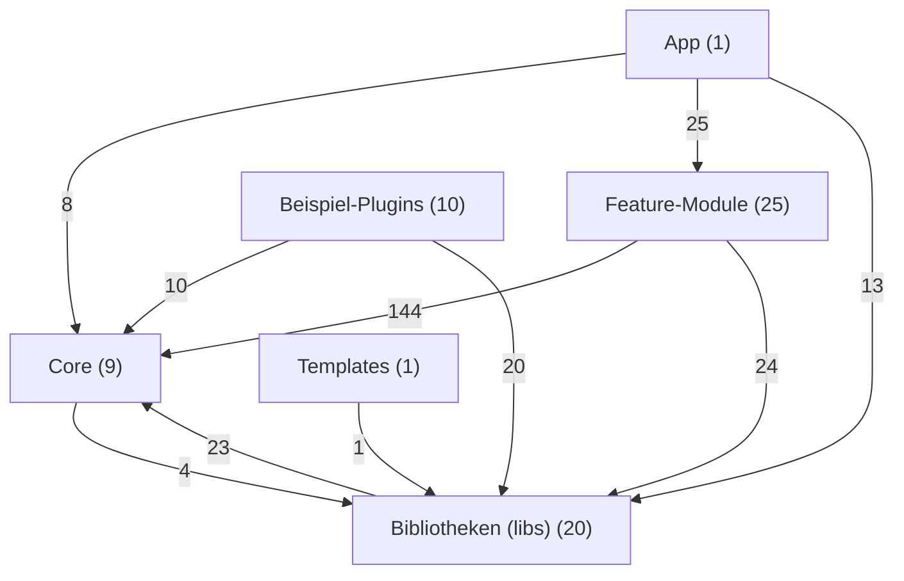

# Modulgraph

Automatisch erzeugt mit `python3 scripts/gen-module-graph.py` — nicht von Hand ändern.

66 Module, 312 direkte Projektabhängigkeiten.

## Schichten (aggregiert)

## Abhängigkeiten je Modul

### App

| Modul | hängt ab von |
|---|---|
| `:app` | `:core:common`, `:core:data`, `:core:datastore`, `:core:designsystem`, `:core:domain`, `:core:navigation`, `:core:resources`, `:core:ui`, `:feature:assetstudio`, `:feature:build`, `:feature:composepreview`, `:feature:debug`, `:feature:dependencies`, `:feature:dependencyupdates`, `:feature:editor`, `:feature:filetree`, `:feature:git`, `:feature:hardcodedstrings`, `:feature:j2k`, `:feature:layoutdesigner`, `:feature:modulemaker`, `:feature:onboarding`, `:feature:plugins`, `:feature:projectsettings`, `:feature:projectwizard`, `:feature:sdkmanager`, `:feature:search`, `:feature:settings`, `:feature:signing`, `:feature:terminal`, `:feature:themebuilder`, `:feature:welcome`, `:feature:x2c`, `:libs:ai-client`, `:libs:dependency-updater-api`, `:libs:dependency-updater-impl`, `:libs:gradle-tooling-bridge`, `:libs:indexing-api`, `:libs:indexing-impl`, `:libs:lsp-client`, `:libs:plugin-api`, `:libs:plugin-impl`, `:libs:template-engine`, `:libs:terminal-engine`, `:libs:termux-app`, `:libs:x2c` |

### Feature-Module

| Modul | hängt ab von |
|---|---|
| `:feature:onboarding` | `:core:datastore`, `:core:designsystem`, `:core:domain`, `:core:navigation`, `:core:resources`, `:core:ui`, `:libs:terminal-engine`, `:libs:termux-app` |
| `:feature:welcome` | `:core:common`, `:core:designsystem`, `:core:domain`, `:core:navigation`, `:core:resources`, `:core:ui` |
| `:feature:projectwizard` | `:core:datastore`, `:core:designsystem`, `:core:domain`, `:core:navigation`, `:core:resources`, `:core:testing`, `:core:ui`, `:libs:template-engine` |
| `:feature:editor` | `:core:datastore`, `:core:designsystem`, `:core:domain`, `:core:navigation`, `:core:resources`, `:core:testing`, `:core:ui`, `:libs:ai-client`, `:libs:code-tools`, `:libs:debug-client`, `:libs:dependency-updater-api`, `:libs:lsp-client` |
| `:feature:composepreview` | `:core:designsystem`, `:core:domain`, `:core:navigation`, `:core:resources`, `:core:ui`, `:libs:terminal-engine` |
| `:feature:filetree` | `:core:common`, `:core:datastore`, `:core:designsystem`, `:core:domain`, `:core:navigation`, `:core:resources`, `:core:testing`, `:core:ui` |
| `:feature:terminal` | `:core:datastore`, `:core:designsystem`, `:core:domain`, `:core:navigation`, `:core:resources`, `:core:ui`, `:libs:terminal-engine` |
| `:feature:sdkmanager` | `:core:designsystem`, `:core:domain`, `:core:navigation`, `:core:resources`, `:core:ui` |
| `:feature:layoutdesigner` | `:core:designsystem`, `:core:domain`, `:core:navigation`, `:core:resources`, `:core:ui` |
| `:feature:assetstudio` | `:core:designsystem`, `:core:domain`, `:core:resources`, `:core:ui` |
| `:feature:themebuilder` | `:core:datastore`, `:core:designsystem`, `:core:domain`, `:core:navigation`, `:core:resources`, `:core:testing`, `:core:ui` |
| `:feature:git` | `:core:designsystem`, `:core:domain`, `:core:navigation`, `:core:resources`, `:core:testing`, `:core:ui` |
| `:feature:plugins` | `:core:designsystem`, `:core:domain`, `:core:navigation`, `:core:resources`, `:core:ui`, `:libs:plugin-api` |
| `:feature:settings` | `:core:common`, `:core:datastore`, `:core:designsystem`, `:core:domain`, `:core:navigation`, `:core:resources`, `:core:testing`, `:core:ui`, `:libs:terminal-engine`, `:libs:termux-shared` |
| `:feature:dependencyupdates` | `:core:navigation`, `:core:resources`, `:libs:dependency-updater-api` |
| `:feature:dependencies` | `:core:common`, `:core:designsystem`, `:core:domain`, `:core:navigation`, `:core:resources`, `:core:testing`, `:core:ui`, `:libs:dependency-updater-api` |
| `:feature:search` | `:core:designsystem`, `:core:domain`, `:core:navigation`, `:core:resources`, `:core:ui`, `:libs:code-tools` |
| `:feature:modulemaker` | `:core:designsystem`, `:core:domain`, `:core:navigation`, `:core:resources`, `:core:ui`, `:libs:code-tools` |
| `:feature:hardcodedstrings` | `:core:designsystem`, `:core:domain`, `:core:navigation`, `:core:resources`, `:core:ui`, `:libs:hardcoded-strings` |
| `:feature:build` | `:core:designsystem`, `:core:domain`, `:core:navigation`, `:core:resources`, `:core:testing`, `:core:ui`, `:libs:terminal-engine` |
| `:feature:signing` | `:core:designsystem`, `:core:domain`, `:core:navigation`, `:core:resources`, `:core:testing`, `:core:ui`, `:libs:terminal-engine`, `:libs:termux-shared` |
| `:feature:debug` | `:core:designsystem`, `:core:domain`, `:core:navigation`, `:core:resources`, `:core:testing`, `:core:ui`, `:libs:debug-client` |
| `:feature:j2k` | `:core:designsystem`, `:core:domain`, `:core:navigation`, `:core:resources`, `:core:ui`, `:libs:j2k` |
| `:feature:projectsettings` | `:core:data`, `:core:designsystem`, `:core:domain`, `:core:navigation`, `:core:resources`, `:core:ui` |
| `:feature:x2c` | `:core:datastore`, `:core:designsystem`, `:core:domain`, `:core:navigation`, `:core:resources`, `:core:ui`, `:libs:x2c` |

### Core

| Modul | hängt ab von |
|---|---|
| `:core:resources` | – |
| `:core:designsystem` | `:core:datastore`, `:core:domain`, `:core:resources`, `:core:testing` |
| `:core:ui` | `:core:resources` |
| `:core:common` | – |
| `:core:data` | `:core:common`, `:core:domain`, `:core:resources`, `:core:testing`, `:libs:code-tools`, `:libs:dependency-updater-api` |
| `:core:domain` | `:core:common`, `:core:resources`, `:core:testing`, `:libs:j2k`, `:libs:x2c` |
| `:core:datastore` | `:core:common`, `:core:resources` |
| `:core:navigation` | – |
| `:core:testing` | `:core:resources` |

### Bibliotheken (libs)

| Modul | hängt ab von |
|---|---|
| `:libs:terminal-engine` | `:core:datastore`, `:core:domain`, `:core:resources`, `:libs:termux-emulator`, `:libs:termux-shared` |
| `:libs:gradle-tooling-bridge` | `:core:domain`, `:core:resources`, `:core:testing`, `:libs:terminal-engine` |
| `:libs:lsp-client` | `:core:domain`, `:core:resources` |
| `:libs:debug-client` | `:core:common`, `:core:domain`, `:core:resources`, `:core:testing`, `:libs:indexing-api`, `:libs:terminal-engine` |
| `:libs:template-engine` | `:core:domain`, `:core:resources` |
| `:libs:plugin-api` | `:core:domain`, `:libs:terminal-engine` |
| `:libs:plugin-impl` | `:core:domain`, `:core:resources`, `:libs:plugin-api`, `:libs:terminal-engine` |
| `:libs:indexing-api` | – |
| `:libs:indexing-impl` | `:core:resources`, `:libs:indexing-api` |
| `:libs:dependency-updater-api` | – |
| `:libs:dependency-updater-impl` | `:core:resources`, `:libs:dependency-updater-api`, `:libs:indexing-api`, `:libs:indexing-impl` |
| `:libs:code-tools` | – |
| `:libs:hardcoded-strings` | – |
| `:libs:ai-client` | `:core:common`, `:core:domain`, `:core:resources`, `:core:testing` |
| `:libs:j2k` | – |
| `:libs:x2c` | – |
| `:libs:termux-emulator` | – |
| `:libs:termux-view` | `:libs:termux-emulator` |
| `:libs:termux-shared` | `:libs:termux-view` |
| `:libs:termux-app` | `:libs:termux-shared`, `:libs:termux-view` |

### Beispiel-Plugins

| Modul | hängt ab von |
|---|---|
| `:examples:lsp-plugin-common` | `:core:domain`, `:libs:plugin-api`, `:libs:terminal-engine` |
| `:examples:kotlin-lsp-plugin` | `:core:domain`, `:examples:lsp-plugin-common`, `:libs:plugin-api`, `:libs:terminal-engine` |
| `:examples:java-lsp-plugin` | `:core:domain`, `:examples:lsp-plugin-common`, `:libs:plugin-api`, `:libs:terminal-engine` |
| `:examples:xml-lsp-plugin` | `:core:domain`, `:examples:lsp-plugin-common`, `:libs:plugin-api`, `:libs:terminal-engine` |
| `:examples:cpp-lsp-plugin` | `:core:domain`, `:examples:lsp-plugin-common`, `:libs:plugin-api`, `:libs:terminal-engine` |
| `:examples:bash-lsp-plugin` | `:core:domain`, `:examples:lsp-plugin-common`, `:libs:plugin-api`, `:libs:terminal-engine` |
| `:examples:yaml-lsp-plugin` | `:core:domain`, `:examples:lsp-plugin-common`, `:libs:plugin-api`, `:libs:terminal-engine` |
| `:examples:toml-lsp-plugin` | `:core:domain`, `:examples:lsp-plugin-common`, `:libs:plugin-api`, `:libs:terminal-engine` |
| `:examples:kmp-lsp-plugin` | `:core:domain`, `:examples:lsp-plugin-common`, `:libs:plugin-api`, `:libs:terminal-engine` |
| `:examples:python-lsp-plugin` | `:core:domain`, `:examples:lsp-plugin-common`, `:libs:plugin-api`, `:libs:terminal-engine` |

### Templates

| Modul | hängt ab von |
|---|---|
| `:templates:code-plugin` | `:libs:plugin-api` |

## Detail: `:app` und seine direkten Abhängigkeiten

```mermaid
flowchart LR
    app --> n_core_common[":core:common"]
    app --> n_core_data[":core:data"]
    app --> n_core_datastore[":core:datastore"]
    app --> n_core_designsystem[":core:designsystem"]
    app --> n_core_domain[":core:domain"]
    app --> n_core_navigation[":core:navigation"]
    app --> n_core_resources[":core:resources"]
    app --> n_core_ui[":core:ui"]
    app --> n_feature_assetstudio[":feature:assetstudio"]
    app --> n_feature_build[":feature:build"]
    app --> n_feature_composepreview[":feature:composepreview"]
    app --> n_feature_debug[":feature:debug"]
    app --> n_feature_dependencies[":feature:dependencies"]
    app --> n_feature_dependencyupdates[":feature:dependencyupdates"]
    app --> n_feature_editor[":feature:editor"]
    app --> n_feature_filetree[":feature:filetree"]
    app --> n_feature_git[":feature:git"]
    app --> n_feature_hardcodedstrings[":feature:hardcodedstrings"]
    app --> n_feature_j2k[":feature:j2k"]
    app --> n_feature_layoutdesigner[":feature:layoutdesigner"]
    app --> n_feature_modulemaker[":feature:modulemaker"]
    app --> n_feature_onboarding[":feature:onboarding"]
    app --> n_feature_plugins[":feature:plugins"]
    app --> n_feature_projectsettings[":feature:projectsettings"]
    app --> n_feature_projectwizard[":feature:projectwizard"]
    app --> n_feature_sdkmanager[":feature:sdkmanager"]
    app --> n_feature_search[":feature:search"]
    app --> n_feature_settings[":feature:settings"]
    app --> n_feature_signing[":feature:signing"]
    app --> n_feature_terminal[":feature:terminal"]
    app --> n_feature_themebuilder[":feature:themebuilder"]
    app --> n_feature_welcome[":feature:welcome"]
    app --> n_feature_x2c[":feature:x2c"]
    app --> n_libs_ai_client[":libs:ai-client"]
    app --> n_libs_dependency_updater_api[":libs:dependency-updater-api"]
    app --> n_libs_dependency_updater_impl[":libs:dependency-updater-impl"]
    app --> n_libs_gradle_tooling_bridge[":libs:gradle-tooling-bridge"]
    app --> n_libs_indexing_api[":libs:indexing-api"]
    app --> n_libs_indexing_impl[":libs:indexing-impl"]
    app --> n_libs_lsp_client[":libs:lsp-client"]
    app --> n_libs_plugin_api[":libs:plugin-api"]
    app --> n_libs_plugin_impl[":libs:plugin-impl"]
    app --> n_libs_template_engine[":libs:template-engine"]
    app --> n_libs_terminal_engine[":libs:terminal-engine"]
    app --> n_libs_termux_app[":libs:termux-app"]
    app --> n_libs_x2c[":libs:x2c"]
```

