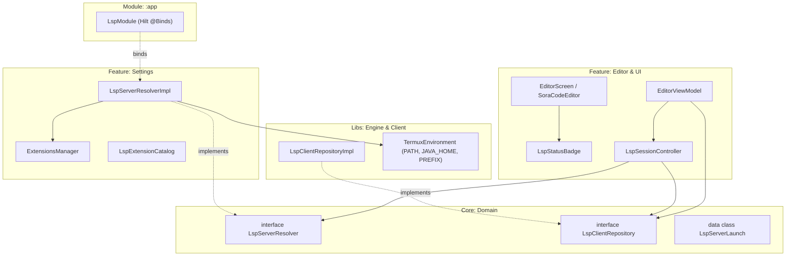

# 🧩 Verifikations- & Abschlussbericht: Extensions-Manager Reparatur & LSP-Anbindung (Task 23)

> **Datum:** 16. Oktober 2026  
> **Status:** Erfolgreich umgesetzt & verifiziert  
> **Arbeitsbereich:** `:feature:settings`, `:core:domain`, `:core:resources`, `:feature:editor`, `:libs:lsp-client`, `:app`  
> **Referenz:** `agy-tasks/23-fix-extensions-manager.md`, Task 16 Punkt 4

---

## 1. Zusammenfassung

Der Extensions-Manager (`feature/settings/.../extensions/`) und der Language-Server-Client (`:libs:lsp-client`) wurden grundlegend überarbeitet, gehärtet und vollständig an den Sora-Code-Editor in `:feature:editor` angebunden:

1. **Echte SHA-256-Prüfsummen & Archivtypen:** Alle Prüfsummen wurden aus realen Original-Downloads (GitHub Releases, Eclipse Foundation, npm Registry) berechnet und gegen die npm-`dist.integrity` (SHA-512) gegengeprüft. Falsche ZIP-Typen wurden auf `TAR_GZ` bzw. `GZ` korrigiert.
2. **Plattform-Inkompatibilitäten gelöst:** Die inkompatiblen x86_64- und glibc-Binaries für `clangd` und `rust-analyzer` wurden durch native Termux-Pakete (`ExtensionSource.TermuxPackage`) ersetzt (im CodeForge APT-Repo über `apt-stages.conf` Stage 10 und 15 bereitgestellt).
3. **Laufzeitvoraussetzungen (`requires`):** Pakete deklarieren ihre Abhängigkeiten (`openjdk-17`, `nodejs`, `python`, `clang`, `rust-analyzer`). Fehlende Laufzeitkomponenten werden im Dateisystem / `$PREFIX/bin` / `$PATH` erkannt und in der UI als zweisprachige Warnung („Voraussetzung fehlt: ...“) signalisiert.
4. **Sicheres Entpacken ohne Fremdbibliotheken (`ArchiveUtils.kt`):**
   - Unterstützung für `ZIP`, `TAR_GZ` (mittels `GZIPInputStream` + leichtgewichtigem ustar/GNU-Tar-Reader) und `GZ`.
   - Schutz vor Zip-Slip, Pfad-Traversal und Symlink-Ausbrüchen aus dem Zielverzeichnis.
   - Erhalt der Tar-Modus-Ausführungsrechte und Heuristik für `.sh`/`bin`.
   - Atomares Aufräumen: Bei Fehlern werden unvollständige Verzeichnisse und temporäre Archive gelöscht; nach erfolgreicher Installation wird das Download-Archiv entfernt.
5. **Architektur-konforme Anbindung an den Editor:**
   - `:core:domain` definiert `LspServerResolver` und `LspServerLaunch`.
   - `:feature:settings` implementiert `LspServerResolverImpl` unter Verwendung von `ExtensionsManager` und `TermuxEnvironment.environment()`.
   - `:app` bindet die Implementierung via Hilt (`LspModule.kt`).
   - `:feature:editor` steuert über `LspSessionController` den Lebenszyklus des LSP-Servers (ein Server pro Workspace und Sprache, automatischer Wechsel und Stopp).
   - Serverzustand (`LspServerState`) wird in der Statusleiste (`LspStatusBadge`) visualisiert.
6. **Bereinigung des Repositories:**
   - Duplikat `plan-apt-build.sh` im Root entfernt, Verweise auf `.github/scripts/plan-apt-build.sh` vereinheitlicht.
   - `mirror-integration.patch` aus Git entfernt.
   - Veraltete `values-en`-Doku-Referenzen bereinigt.
   - Stringanzahl in allen Dokumenten auf den exakten Stand von **834 Strings** je Sprache angeglichen.

---

## 2. Katalog-Abgleich: Alt vs. Neu

| Paket / ID | Version | Quelle (Typ) | SHA-256 (Alt) | SHA-256 (Neu, verifiziert) | Archivtyp (Alt → Neu) | Startkommando / Binary | Voraussetzungen (`requires`) |
|---|---|---|---|---|---|---|---|
| **kotlin-language-server** | 1.3.11 | GitHub Releases | `c08e8df5e8c1...` ❌ | `c65efea1c09d88ddb1fe227d8e2c5dbb3d8dd568453bccbbf2e20dfa2f004dcd` ✅ | `ZIP` → `ZIP` | `server/bin/kotlin-language-server` | `openjdk-17` |
| **jdtls** | 1.45.0 | Eclipse Milestones | `09462fc74805...` ❌ | `c09e79e958beb5ce41fb3b5097aec0455298bc88a14c8e41462b57edb2812797` ✅ | `ZIP` ❌ → `TAR_GZ` ✅ | `bin/jdtls` (Python-Launcher) | `openjdk-17`, `python` |
| **pyright** | 1.1.377 | npm Registry | `91a826bcddbe...` ❌ | `b11dc22e92560b38ebad99a892544d9ce81e2ce995db430b3683e86db57d7710` ✅ | `ZIP` ❌ → `TAR_GZ` ✅ | `node package/langserver.index.js --stdio` | `nodejs` |
| **vscode-langservers-extracted** | 4.8.0 | npm Registry | `2f6c096abec...` ❌ | `8c7102927a32fa145077f0406b66bb3a7d85f5b0a208d4efeb40702b5a6cd2e1` ✅ | `ZIP` ❌ → `TAR_GZ` ✅ | `node package/bin/vscode-<lang>-language-server --stdio` | `nodejs` |
| **clangd** | 18.1.3 | `ExtensionSource.TermuxPackage` | `1d6c818fa8f8...` ❌ (x86_64 glibc) | N/A (Termux-Paket `clang`) ✅ | `ZIP` ❌ → Termux-Binary ✅ | `$PREFIX/bin/clangd` | `clang` |
| **rust-analyzer** | 1.79.0 | `ExtensionSource.TermuxPackage` | `8f307ebc31bc...` ❌ (aarch64 glibc) | N/A (Termux-Paket `rust-analyzer`) ✅ | `BINARY` ❌ → Termux-Binary ✅ | `$PREFIX/bin/rust-analyzer` | `rust-analyzer` |

### Begründung der Änderungen:
- **`jdtls`:** Die frühere URL ohne Milestone-Zeitstempel lieferte HTTP 404. Auf Eclipse Milestones 1.45.0 aktualisiert (`jdt-language-server-1.45.0-202502271238.tar.gz`).
- **`clangd` & `rust-analyzer`:** Upstream-Binaries sind gegen die GNU C Library (glibc) gelinkt bzw. x86_64-Architektur. Auf Android (Bionic C Library) stürzen sie mit Linker-Fehlern ab. Die Einbindung erfolgt sauber über die nativen Termux-Pakete `clang` und `rust-analyzer` im CodeForge APT-Repo.
- **npm-Integrität:**
  - `pyright`: Registry SHA-512 `y6ENYuyZXTczPnPWZnqx78pE+ZgyIotEas2M/LFRTq3EfbgVk84EcvuSKLIy2DJeDKjKDxVP/LVmDNHabljD3g==` validiert.
  - `vscode-langservers-extracted`: Registry SHA-512 `kWqVdmdcf9Ez1P3hZpvCHomxVqrdK2awwZkezSW3SuXLX0kXS4x8WoA0GkF54SA0CiXtJWszaFpQghUNVlepuQ==` validiert.

---

## 3. Architektur der Editor-Anbindung

- **Keine direkte Feature-zu-Feature-Abhängigkeit:** `:feature:editor` hängt nur von `:core:domain` und `:libs:lsp-client` ab.
- **Lebenszyklusverwaltung:**
  - `onFileOpened(languageId, workspaceRoot)`: Startet den passenden Server bei Bedarf.
  - Bei Wechsel der Programmiersprache (z. B. Kotlin → Java) oder des Workspaces wird der vorherige Server beendet (`stop()`).
  - Wenn alle Tabs geschlossen werden oder das Projekt geschlossen wird, wird der Server gestoppt.
  - Server-Zustände (`STOPPED`, `STARTING`, `RUNNING`, `FAILED`, `ERROR`) werden reaktiv an die UI propagiert.
- **Fehlerbehandlung:** Wenn ein Server fehlt oder der Start fehlschlägt, wechselt der Zustand auf `ERROR`, eine Snackbar informiert den Benutzer und verweist auf „Einstellungen → Extensions“. Es treten keine Abstürze auf.

---

## 4. Testabdeckung & Verifikation

Folgende automatisierte Tests sichern die Funktionalität ab:

1. **`ArchiveUtilsTest` (`:feature:settings`):**
   - Extraktion von `ZIP`, `TAR_GZ` und `GZ`.
   - Abwehr von Zip-Slip (`../escaped.txt`) und Tar-Slip (`../../etc/evil.sh`).
   - Abwehr von Symlink-Ausbrüchen außerhalb des Zielverzeichnisses.
   - Erhalt des Ausführungsbits (`setExecutable`) bei Skripten und Binaries.
   - Atomares Löschen des Zielordners bei Extraktionsfehlern.
2. **`LspExtensionCatalogTest` (`:feature:settings`, offline):**
   - Eindeutigkeit aller Paket-IDs.
   - Gültigkeit aller Download-URLs (`https://`) und 64-stelliger Hex-SHA-256.
   - Konsistenz von Archivtyp und Dateiendung.
   - Vollständigkeit von `launchCommand` und `executableRelativePath`.
   - Validierung der Termux-Pakete (`clangd`, `rust-analyzer`).
3. **`ExtensionsManagerTest` (`:feature:settings`):**
   - End-to-End-Installations- und Deinstallations-Lebenszyklus für ZIP, TAR_GZ und GZ mit Mock-Downloader.
   - Verifikation, dass fehlerhafte SHA-256-Prüfsummen den Download verwerfen und keine Verzeichnisse hinterlassen.
   - Erkennung installierter Termux-Pakete im Prefix.
   - Prüfung fehlender Laufzeitabhängigkeiten (`checkMissingRequirements`).
4. **`LspSessionControllerTest` (`:feature:editor`):**
   - Resolver liefert `null` → kein Start, Status `STOPPED`.
   - Resolver liefert Startkommando → genau ein Aufruf von `start()`, Status `RUNNING`.
   - Sprach- oder Projektwechsel → vorheriger Server wird mit `stop()` beendet.
   - Startfehler oder Exceptions führen zu Status `ERROR` ohne Absturz.
5. **Katalog-Verifikationsskript `scripts/verify-extension-catalog.sh`:**
   - Lädt alle 4 Download-Archive herunter und validiert die SHA-256-Prüfsummen.
   - ShellCheck geprüft (Exit Code 0).

---

## 5. Repository-Bereinigung & String-Status

- **`plan-apt-build.sh`:** Duplikat im Projekt-Root entfernt (`git rm plan-apt-build.sh`), alle Referenzen auf `.github/scripts/plan-apt-build.sh` umgebogen.
- **`mirror-integration.patch`:** Aus dem Git-Tracking entfernt (`git rm --cached`).
- **Dokumentations-Referenzen:** `values-en`-Reste in `docs/project-wizard-and-template-engine.md`, `agy-tasks/13-verify-resources.md` und `STATUS.md` bereinigt.
- **String-Synchronisation:**
  - Neue Strings für Termux-Hinweise, Voraussetzungen und LSP-Status hinzugefügt.
  - `python3 scripts/check_string_locales.py` bestätigt **834 Strings** synchron in Englisch (`values/`) und Deutsch (`values-de/`).
  - `python3 scripts/find_hardcoded_strings.py --check` meldet 0 hartcodierte Strings.
  - Dokumente (`docs/resources-and-strings.md`, `docs/restore-lost-editor-features.md`, `agy-tasks/17-externalize-hardcoded-strings.md`, `agy-tasks/TASKS-STATUS.md`, `STATUS.md`) auf 834 aktualisiert.

---

## 6. Offene Punkte für den Repository-Inhaber (außerhalb dieses Repos)

1. **Paketrezepte committen:** Die Rezepte `flutter`, `typescript`, `jdtls`, `lemminx`, `kotlin-lsp` unter `agy-output/packages/` gehören in den Fork `scto/terminal-packages-codeforge` (`packages/`) und müssen dort eingecheckt werden.
2. **Manueller Gerätetest:** Test von echten LSP-Sitzungen (Code-Vervollständigung und Diagnosen auf dem physischen Gerät mit installiertem JDK / Node.js) anhand von `docs/device-test-checklist.md`.
