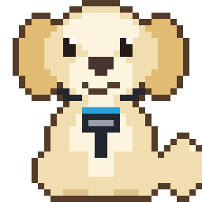

---
hide:
  - navigation
  - toc
---

# CodeForge Mobile

*Gewidmet [Basti](basti.md), meinem Golden Retriever.*

Native Android-IDE mit Sora Editor, Termux-Shell, Git, Language Server, Compose-Live-Preview und visuellem Layout-Designer – gebaut mit Kotlin, Jetpack Compose und Material 3 Expressive.

[APK herunterladen](https://github.com/scto/CodeForgeMobile/releases){ .md-button .md-button--primary }
[Anwenderhandbuch](user/Anwenderhandbuch.md){ .md-button }
[Quellcode](https://github.com/scto/CodeForgeMobile){ .md-button }

### Store
Plugins · Themes · Werkzeuge

Farbschemata, Icon-Pakete, Sprachpakete, LSP-Server, Formatierer und Werkzeug-Plugins. Der Katalog wird live geladen; die App nutzt denselben Katalog unter Einstellungen → Store.

[Zum Store](store.md){ .md-button .md-button--primary }

### APT-Repo
Pakete für die Termux-Shell

Eigenes, signiertes APT-Repository für das Präfix `com.codeforge.app`: JDK, Build-Werkzeuge, Git und mehr. Durchsuchbar, mit Quellzeile zum Einbinden.

[Zum APT-Repo](apt.md){ .md-button .md-button--primary }

### Dokumentation
Handbücher · Entwickler · API

Anwenderhandbuch (DE), User Guide (EN), Entwicklerhandbuch mit Modulgraph, APK-Dokumentation und die KDoc-API-Referenz.

[Zur Dokumentation](user/Anwenderhandbuch.md){ .md-button .md-button--primary }
[API-Referenz](api/index.html){ .md-button }

## Screenshots

| Startseite | Über CodeForge Mobile |
|:---:|:---:|
| { width=240 }{ width=240 } | { width=240 }{ width=240 } |

Die Bilder entstehen aus Compose-Screenshot-Tests mit Beispieldaten; Schriften und Systemleisten können auf einem Gerät abweichen.

!!! warning "Entwicklungsstand"
    Die Release-Pipeline läuft, die Release-APK ist aber noch nicht auf Geräten geprüft. Stand und offene Punkte: [Release Notes 3.0.4](release-notes/3.0.4.md).
