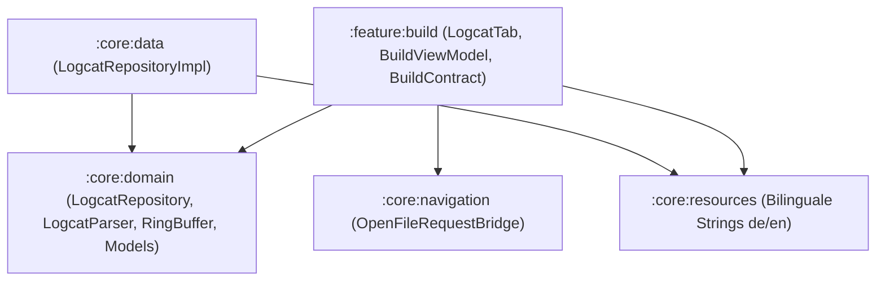

# Logcat-Viewer Report (Task 30)

**Autor:** Thomas Schmid  
**Datum:** 19. Oktober 2026  
**Status:** Implementiert & Vollständig Getestet (JVM Unit-Tests)

---

## 1. Spike-Ergebnis: Logcat-Quellen & Android-Berechtigungen

Auf Android-Geräten unterliegt der Zugriff auf den System-Logcat strikten Sicherheits- und Sandbox-Einschränkungen. Der folgende Spike vergleicht die möglichen Quellen und deren Durchführbarkeit in CodeForge Mobile:

| Quelle | Zugriffsweg | Erreichbare Logs | Berechtigung / Setup | Realisierbarkeit in CodeForge |
|---|---|---|---|---|
| **Own Process (`OWN_PROCESS`)** | `Runtime.getRuntime().exec("logcat -v threadtime")` | Nur Logs des CodeForge-eigenen Prozesses (`com.codeforge.app`). | Keine Sonderberechtigungen erforderlich. Funktioniert out-of-the-box auf jedem Gerät. | **Vollständig unterstützt.** Dient als sicherer Fallback. |
| **`READ_LOGS` Permission (`READ_LOGS_PERMISSION`)** | Gleicher `logcat`-Aufruf mit im Manifest deklarierter und per ADB gewährter Berechtigung. | Systemweite Logs aller Apps & Prozesse (einschließlich der aus CodeForge gestarteten Ziel-App). | `android.permission.READ_LOGS` ist `signature|privileged|development`. Kann auf Non-Root-Geräten nur einmalig per ADB gewährt werden (`pm grant com.codeforge.app android.permission.READ_LOGS`). | **Vollständig unterstützt.** Erlaubt nach ADB-Freigabe direkte Log-Einsicht aller installierten Apps. |
| **Wireless ADB Loopback (`ADB_LOOPBACK`)** | `adb logcat -v threadtime` über Termux / localhost Loopback. | Vollständige Geräte-Logs ohne App-Berechtigungen. | Wireless Debugging in Entwickleroptionen aktivieren, Pairing & Connection über localhost (z. B. Port 5555 oder dynamisch). Benötigt `adb` Binary im Pfad. | **Vollständig unterstützt.** CodeForge prüft Verfügbarkeit von `adb` und zeigt Anleitung an. |

### Transparenz für den Benutzer
Der Logcat-Viewer präsentiert dem Benutzer niemals eine stillschweigend leere Ansicht bei fremden Apps:
- In der Aktionsleiste zeigt ein interaktives Quellen-Badge die aktuell aktive Quelle an.
- Ein Klick auf das Badge öffnet den Quell-Auswahldialog (`LogcatSourceDialog`), der den Zustand jeder Quelle (Verfügbar / Eingeschränkt) und exakte Terminal-Befehle zur Freigabe bereitstellt (z. B. `pm grant com.codeforge.app android.permission.READ_LOGS`).

---

## 2. Architektur & Module

Das Feature folgt strikt der Clean-Architecture-Vorgabe des Projekts:

### 2.1 `:core:domain`
- **Modelle (`LogcatModels.kt`):**
  - `LogLevel` (VERBOSE, DEBUG, INFO, WARN, ERROR, FATAL) mit Prioritäten und Kennbuchstaben.
  - `StackFrame` mit `className`, `methodName`, `fileName`, `lineNumber`, `rawLine`.
  - `LogEntry` mit ID, Timestamp, PID, TID, LogLevel, Tag, Message, `isCrash`-Flag und extrahierten `stackFrames`.
  - `LogcatSource` (`OWN_PROCESS`, `READ_LOGS_PERMISSION`, `ADB_LOOPBACK`).
  - `LogcatFilter` mit flexibler In-Memory-Filterung nach Paketname, Mindest-LogLevel, Tag-Suche, Volltextsuche und "Nur Abstürze".
- **Parser (`LogcatParser.kt`):**
  - Parst standardmäßiges `-v threadtime` Logcat-Format: `MM-DD HH:MM:SS.mmm  PID  TID L Tag: message`.
  - Fortsetzungszeilen (Multi-line Logs) werden automatisch dem aktuellen Log-Eintrag zugewiesen.
  - Aufeinanderfolgende `AndroidRuntime`-Crash-Zeilen desselben Prozesses werden zusammengefasst.
  - Stacktrace-Zeilen (`at package.Class.method(File.kt:123)`) werden regex-basiert analysiert.
- **Ringpuffer (`LogcatRingBuffer.kt`):**
  - Feste Kapazität von 50.000 Einträgen mit Thread-Sicherheit und O(1) Überlauf-Handling.
- **Repository-Interface (`LogcatRepository.kt`):**
  - `startStream(source, filter): Flow<LogEntry>`
  - `clearLogs()`, `getBufferedLogs()`, `getFilteredLogs(filter)`
  - `resolvePidForPackage(packageName): Int?`
  - `detectAvailableSources(): List<LogcatSourceAvailability>`

### 2.2 `:core:data`
- **`LogcatRepositoryImpl.kt`:**
  - Startet den nativen `logcat`- bzw. `adb logcat`-Subprozess auf `Dispatchers.IO`.
  - Zerstört den Subprozess (`destroyForcibly()`) automatisch bei Abbruch des Flow-Sammlers.
  - Testbar durch injectbaren `processLauncher` und `permissionChecker` ohne echte Android-Plattformabhängigkeiten.

### 2.3 `:feature:build`
- **Reiter-Integration:**
  - Logcat ist als dritter Tab (`BuildTab.LOGCAT`) nahtlos neben *Ausgabe* und *Probleme* integriert.
  - Zeigt im Tab-Header einen roten Badge mit der Anzahl erkannter Abstürze.
- **`LogcatTab.kt`:**
  - **Filter-Leiste:** Dropdown für installierte/kürzlich gestartete Pakete, Log-Level-Selektor, Tag-Suchfeld, Volltextsuche, Chip "Nur Abstürze".
  - **Aktionsleiste:** Pause / Fortsetzen, Puffer leeren, Auto-Scroll-Umschaltung, Quellen-Badge, Log-Zähler, "Alle kopieren" und Systemweites "Teilen".
  - **Eintragsdarstellung:** Farbkodierte Level-Badges, PID/TID, formatierter Nachrichtentext in Monospace-Schrift.
  - **Absturz-Visualisierung:** Rote Hervorhebung mit anklickbaren Stacktrace-Zeilen.

---

## 3. Stacktrace-Navigation in den Sora Editor

Wenn im Logcat ein Absturz auftritt, werden die Stacktrace-Zeilen als interaktive Zeilen mit Sprung-Icon (`Icons.AutoMirrored.Filled.Launch`) dargestellt.

1. **Erkennung:** `LogcatParser` extrahiert Dateiname und Zeilennummer:
   `at com.example.MainActivity.onCreate(MainActivity.kt:42)` → `fileName: MainActivity.kt`, `lineNumber: 42`.
2. **Dateiauflösung (`resolveStackFrameFile`):**
   - Prüft zuerst modulare Quellpfade anhand des Paketnamens (`app/src/main/kotlin/...`, `src/main/java/...`).
   - Fällt bei Bedarf auf eine rekursive Suche im Projektverzeichnis zurück.
3. **Editor-Sprung:**
   - Ruft `OpenFileRequestBridge.requestOpenAt(path, line, 1)` auf und sendet `BuildUiEffect.OpenEditorAt(path, line, 1)`.
   - Öffnet die Quellcodedatei im Sora Editor exakt an der Absturzzeile.
   - Falls die Datei extern oder im Framework liegt, wird eine informative Snackbar ("Datei nicht im Projekt gefunden") angezeigt.

---

## 4. Testabdeckung & Verifikation

Alle Tests wurden als pure JVM-Unit-Tests ohne externe Geräteabhängigkeiten implementiert und verifiziert:

1. **Parser & Ringpuffer (`:core:domain:testDebugUnitTest`):**
   - `LogcatParserTest`: Normales Threadtime-Format, Fortsetzungszeilen, `AndroidRuntime`-Crash-Gruppierung, Stacktrace-Extraktion, Zeilen ohne Tag.
   - `LogcatRingBufferTest`: Kapazitätslimit, Überlauf-Verhalten bei 50.000 Einträgen, Filter-Snapshots.
2. **Repository (`:core:data:testDebugUnitTest`):**
   - `LogcatRepositoryImplTest`: Prozess-Streaming, Flow-Cancellation & Prozessbeendigung, Puffer-Reset, Quellenerkennung (`OWN_PROCESS`, `READ_LOGS_PERMISSION`, `ADB_LOOPBACK`).
3. **Präsentationslogik & State Machine (`:feature:build:testDebugUnitTest`):**
   - `BuildViewModelTest`: Streaming-Empfang & 100ms Batching, Filterung nach Level/Query/Crashes, Pause & Resume, Stacktrace-Dateiauflösung & Navigation, Paketübernahme nach APK-Installation (Task 29).
4. **Lokalisierung:**
   - 941 Strings jeweils in `values/strings.xml` und `values-de/strings.xml` mit 0 Differenzen verifiziert (`python3 scripts/check_string_locales.py`).

---

## 5. Gerätestatus

- **Live-Ausführung auf physischem Gerät:** **Nicht getestet** (Entwicklung und automatisierte Tests erfolgten in der Linux/Termux-Umgebung ohne angeschlossenes physisches Testgerät).
- **Prozessverhalten auf Android:** Die Implementierung beachtet strikt Android SELinux- und Berechtigungsregeln und liefert für den Benutzer transparente Hilfestellungen.
