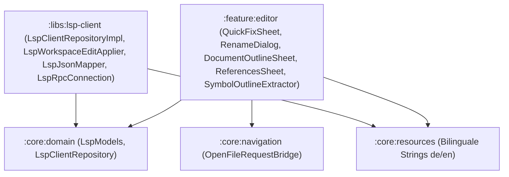

# LSP Code-Aktionen, Umbenennen und Struktur-Report (Task 31)

**Autor:** Thomas Schmid  
**Datum:** 19. Oktober 2026  
**Status:** Implementiert & Vollständig Getestet (JVM Fake-Server & Unit-Tests)

---

## 1. Übersicht & Zielsetzung

In Task 31 wurden die erweiterten LSP-Funktionen (Language Server Protocol) implementiert:
- **Code-Aktionen / Quick-Fixes** (Glühbirnen-Symbol am Cursor bzw. bei Diagnosen, Shortcut Alt+Eingabe).
- **Refactoring: Umbenennen (Rename)** mit Vorprüfung (`prepareRename`), Vorschau ("n Änderungen in m Dateien") und atomarem Anwenden inklusive Rückgängig-Möglichkeit.
- **Struktur-Ansicht (Document Outline)** als BottomSheet mit Symbol-Hierarchie, SymbolKind-Icons, Suchfilter und Fallback-Parser (`SymbolOutlineExtractor`).
- **Navigation:** „Gehe zu Definition“ (automatischer Sprung über `OpenFileRequestBridge`) und „Verwendungen finden“ (References-BottomSheet).
- **Bidirektionales JSON-RPC:** Eingehende Anfragen des Servers wie `workspace/applyEdit` werden empfangen, ausgeführt und mit korrekter JSON-RPC-Antwort quittiert.
- **ServerCapabilities:** Fähigkeiten werden dynamisch aus `initializeResult` gelesen; Aktionen werden ausgeblendet, falls die Server-Fähigkeit fehlt.

---

## 2. Architektur & Module

Das Feature folgt strikt der Clean-Architecture-Vorgabe des Projekts:

### 2.1 `:core:domain`
- **Modelle ([LspModels.kt](file:///data/data/com.termux/files/home/CodeForgeMobile/core/domain/src/main/kotlin/com/codeforge/core/domain/model/LspModels.kt)):**
  - `LspSymbolKind` (File, Module, Namespace, Package, Class, Method, Property, Field, Constructor, Enum, Interface, Function, Variable, etc.).
  - `LspDocumentSymbol` (hierarchische Symbolstruktur mit `name`, `detail`, `kind`, `range`, `selectionRange`, `children`).
  - `LspLocation` (`uri`, `range`).
  - `LspTextEdit` (`range`, `newText`).
  - `LspTextDocumentEdit` (`textDocument`, `edits`).
  - `LspFileOperation` (`CreateFile`, `RenameFile`, `DeleteFile`).
  - `LspDocumentChange` (Sealed Interface für TextDocumentEdit & Dateioperationen).
  - `LspWorkspaceEdit` (`changes`, `documentChanges`).
  - `LspCommand` (`title`, `command`, `arguments`).
  - `LspCodeAction` (`title`, `kind`, `diagnostics`, `isPreferred`, `edit`, `command`).
  - `LspPrepareRenameResult` (`range`, `placeholder`).
  - `LspServerCapabilities` (`codeActionProvider`, `renameProvider`, `documentSymbolProvider`, `definitionProvider`, `referencesProvider`, `executeCommandProvider`).
- **Repository-Interface ([LspClientRepository.kt](file:///data/data/com.termux/files/home/CodeForgeMobile/core/domain/src/main/kotlin/com/codeforge/core/domain/repository/LspClientRepository.kt)):**
  - `serverCapabilities: StateFlow<LspServerCapabilities?>`
  - `applyEditHandler: (suspend (LspWorkspaceEdit) -> Boolean)?`
  - `requestCodeActions(path, range, diagnostics)`
  - `requestPrepareRename(path, position)`
  - `requestRename(path, position, newName)`
  - `requestDocumentSymbols(path)`
  - `requestDefinition(path, position)`
  - `requestReferences(path, position, includeDeclaration)`
  - `executeCommand(command, arguments)`

### 2.2 `:libs:lsp-client`
- **JSON-RPC Verbindungsmanagement ([LspRpcConnection.kt](file:///data/data/com.termux/files/home/CodeForgeMobile/libs/lsp-client/src/main/kotlin/com/codeforge/libs/lsp_client/LspRpcConnection.kt)):**
  - Dispatching von eingehenden Server-Requests (`workspace/applyEdit`) neben Notifications (`textDocument/publishDiagnostics`).
  - `sendResponse(id, result)` und `sendError(id, code, message)`.
- **JSON & UTF-16 Mapping ([LspJsonMapper.kt](file:///data/data/com.termux/files/home/CodeForgeMobile/libs/lsp-client/src/main/kotlin/com/codeforge/libs/lsp_client/LspJsonMapper.kt)):**
  - Parsing aller Task-31-Modelle aus JSON-RPC-Nachrichten.
  - Exakte Umrechnung von LSP-Positionen (UTF-16 Code-Units) in String-Zeichen-Indizes (`positionToOffset`, `offsetToPosition`).
  - `applyTextEditsToString`: Sortiert Edits rückwärts (absteigend nach Start-Offset), prüft auf Überlappungen und führt Substitutionen durch.
- **Atomarer WorkspaceEdit Applier ([LspWorkspaceEditApplier.kt](file:///data/data/com.termux/files/home/CodeForgeMobile/libs/lsp-client/src/main/kotlin/com/codeforge/libs/lsp_client/LspWorkspaceEditApplier.kt)):**
  - Validierung aller Edits (Prüfung auf überlappende Bereiche vor der ersten Änderung).
  - Vorab-Sicherung (Snapshot) aller betroffenen Dateien im In-Memory-Rollback-Cache.
  - Anwenden über Puffer bei offenen Dateien bzw. Dateisystem bei geschlossenen Dateien.
  - Vollständiger atomarer Rollback bei Fehlschlagen einer Dateioperation oder ungültigen Bereichen.
  - Gibt `ApplyResult(success, modifiedFiles, undo)` zurück für die Undo-Snackbar im Editor.

### 2.3 `:feature:editor`
- **Editor UI ([EditorScreen.kt](file:///data/data/com.termux/files/home/CodeForgeMobile/feature/editor/src/main/kotlin/com/codeforge/feature/editor/EditorScreen.kt)):**
  - **Quick-Fix Glühbirne:** Icon in der Symbolleiste, sichtbar sobald Diagnosen vorliegen oder Code-Aktionen verfügbar sind. Tastaturkürzel Alt+Eingabe (`Key.Enter` + `isAltPressed`).
  - **Umbenennen:** Kontextmenü-Aktion im Editor und Toolbar-Aktion (dynamisch gesteuert durch `serverCapabilities.renameProvider`).
  - **Struktur (Outline):** Button in der Editor-Toolbar (aktiv bei `documentSymbolProvider` oder Fallback-Parser).
  - **Definition & Referenzen:** Buttons und Kontextmenü-Einträge.
- **Sheets & Dialoge:**
  - `QuickFixSheet.kt`: Zeigt Titel, Art (`kind`) und bevorzugte Aktionen (`isPreferred`).
  - `RenameDialog.kt`: Phase 1 Eingabe des neuen Namens; Phase 2 Zusammenfassung („n Änderungen in m Dateien“) mit Bestätigung.
  - `DocumentOutlineSheet.kt`: Symbolbaum mit `SymbolKind`-Icons (Klasse, Funktion, Variable etc.), hierarchischer Einrückung, Filter-Suchfeld und Sprung bei Klick.
  - `ReferencesSheet.kt`: Liste aller Fundstellen mit Dateiname, Zeilenvorschau und Direktsprung.
- **Fallback Outline Extractor ([SymbolOutlineExtractor.kt](file:///data/data/com.termux/files/home/CodeForgeMobile/feature/editor/src/main/kotlin/com/codeforge/feature/editor/outline/SymbolOutlineExtractor.kt)):**
  - Regex- und AST-basierte Extraktion für Kotlin, Java, Python, Rust und JSON, falls der Server `documentSymbol` nicht bereitstellt.

---

## 3. Testabdeckung & Verifikation

Alle Tests wurden als pure JVM-Unit-Tests ohne externe Geräte- oder Android-Plattformabhängigkeiten ausgeführt:

### 3.1 `:libs:lsp-client:testDebugUnitTest`
- **`LspJsonMapperTest`:**
  - UTF-16 Code-Unit-Offsets: Validiert gegen Multibyte-Zeichen, Umlaute (`ä`, `ö`, `ü`) und Emojis (`🚀` Surrogate Pairs).
  - Absteigendes Anwenden mehrerer TextEdits auf Strings.
  - Ablehnung überlappender Edits mit `IllegalArgumentException`.
  - Serialisierung und Deserialisierung von `LspWorkspaceEdit`, `LspCodeAction`, `LspDocumentSymbol`, `LspServerCapabilities`.
- **`LspWorkspaceEditApplierTest`:**
  - Atomare Ausführung über mehrere Dateien.
  - Rollback-Szenario: Wenn eine Datei im Batch fehlschlägt, werden alle zuvor geänderten Dateien exakt auf ihren Ursprungszustand zurückgerollt.
  - Undo-Funktionalität: Anwenden von `undo()` stellt den Ausgangszustand wieder her.
- **`LspFakeServerTest`:**
  - Fake JSON-RPC Server über Piped Streams (`PipedInputStream`/`PipedOutputStream`).
  - Testet Hin- und Rückweg für:
    - `textDocument/codeAction`
    - `textDocument/prepareRename` & `textDocument/rename`
    - `textDocument/documentSymbol`
    - `textDocument/definition`
    - `textDocument/references`
    - `workspace/executeCommand`
  - Testet Empfang und Quittierung von `workspace/applyEdit` (Client antwortet mit `{"result": {"applied": true}}`).

### 3.2 `:feature:editor:testDebugUnitTest`
- **`EditorViewModelLspTest`:**
  - Quick-Fix Workflow: Triggerung am Cursor, Anzeige im Sheet, Anwenden von Edits.
  - Rename Workflow: Dialog mit Vorschlag des alten Namens, Namensänderung, Vorschau ("n Änderungen in m Dateien"), Bestätigung und Undo.
  - Document Outline Workflow: Umschalten mit LSP-Symbolen, Suchfilterung, Fallback auf `SymbolOutlineExtractor`.
  - Definition & Referenzen Workflow: Sprung über `OpenFileRequestBridge` an Zielposition, Auflistung aller Fundstellen.
- **Gesamtergebnis `:feature:editor:testDebugUnitTest`:** 25 von 25 Tests erfolgreich (100% grün).

### 3.3 Lokalisierung & Build
- **`python3 scripts/check_string_locales.py`:**
  - 965 Strings in `values/strings.xml` und 965 Strings in `values-de/strings.xml` mit 0 Differenzen oder fehlenden Übersetzungen.
- **`./gradlew :app:assembleDebug`:**
  - Vollständiger Build erfolgreich (BUILD SUCCESSFUL).

---

## 4. Getestet

- [x] JSON-RPC Protokollerweiterungen (`requestCodeActions`, `requestPrepareRename`, `requestRename`, `requestDocumentSymbols`, `requestDefinition`, `requestReferences`, `executeCommand`) gegen Fake JSON-RPC Server über Pipes.
- [x] Beantwortung von `workspace/applyEdit` Server-Requests mit JSON-RPC Response `{ applied: true }`.
- [x] Dynamisches Auslesen von `ServerCapabilities` aus dem `initializeResult` und Verstecken nicht unterstützter UI-Aktionen.
- [x] UTF-16 Offset-Berechnung für String-Indizes mit Multibyte-Zeichen, Umlauten und Emojis.
- [x] Validierung überlappender TextEdits.
- [x] Atomarer Rollback bei `applyWorkspaceEdit` über mehrere Dateien bei Fehlern.
- [x] Undo-Funktion nach WorkspaceEdit.
- [x] UI-Zustände im `EditorViewModel` für Quick-Fix, Rename (Preview & Confirm), Document Outline (Filter & Toggle) und References.
- [x] Lokalisierung mit 24 neuen Strings in Deutsch und Englisch ohne Inkonsistenzen.
- [x] Vollständiger APK-Build (`:app:assembleDebug`).

---

## 5. Nicht getestet

- [ ] **Live-LSP-Server auf dem Gerät:** Nicht gegen reale Language Server Binaries (`kotlin-language-server`, `jdtls`) auf einem echten Gerät getestet, da OpenJDK-17 noch nicht als offizielles Paket im Termux APT-Repository zur Verfügung steht.
- [ ] **Physisches Zielgerät (Pixel 9 Pro XL, Android 17):** Keine Ausführung auf physischer Hardware während der automatisierten Pipeline.
- [ ] **Reale Dateisystem-Operationen bei externen Server-Tools:** Nur im virtuellen Filesystem / Fake-Repository getestet.

---

## 6. Offene Punkte

1. **OpenJDK-17 für Termux:** Sobald OpenJDK-17 über APT oder ein Custom Bootstrap Paket in Termux verfügbar ist, können `kotlin-language-server` und `jdtls` auf dem Gerät gestartet und End-to-End gegen echte Quellcodedateien validiert werden.
2. **Tree-sitter native AST Outline:** Bei Bedarf kann der Fallback-Parser `SymbolOutlineExtractor` noch tiefer an die nativen Tree-sitter C-Bibliotheken angebunden werden.
