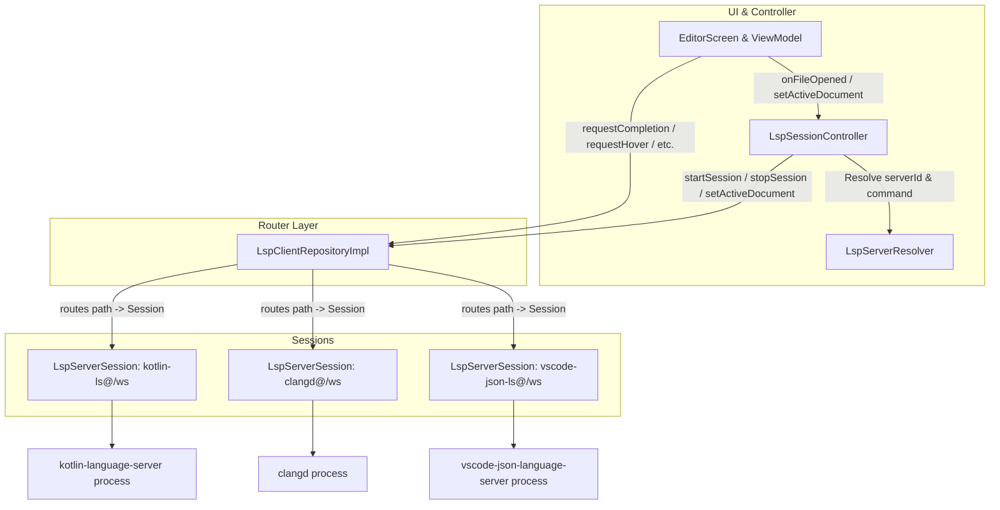

# LSP Multi-Session Architektur- & Testbericht (Task 44)

## 1. Tatsächlicher Datenfluss nach dem Umbau

Vor Task 44 betrieb `CodeForgeMobile` einen globalen Singleton-Prozess für Language Server in `LspClientRepositoryImpl`. Jeder Wechsel zu einem anderen Dateityp (z. B. Kotlin -> YAML -> Kotlin) stoppte den alten Prozess vollständig, wodurch Sprachindizes, Caches und Verbindungszustände verloren gingen.

Mit Task 44 wurde die LSP-Architektur in ein dreischichtiges Router- und Session-Modell überführt:

### Komponenten & Ablauf:
1. **`LspServerSession` (`:libs:lsp-client`):**
   - Kapselt die Prozess-Lifecycle-Steuerung (Start, Stdio, LspRpcConnection, Stop).
   - Verwaltet isoliert Dokumentversionen (`documentVersions`), geöffnete Dateien der Sitzung und den `lastUsedTimestamp`.
   - Empfängt und bearbeitet alle LSP-Anfragen (`requestCompletion`, `requestHover`, `requestFormat`, `requestCodeActions`, `requestRename`, `requestDefinition`, etc.).
2. **`LspClientRepositoryImpl` (Router, `:libs:lsp-client`):**
   - Verwaltet eine `ConcurrentHashMap<String, LspServerSession>`.
   - Sitzungsschlüssel: `"${serverId}@${workspaceRoot}"`.
   - Mappt Dokumentpfade dynamisch auf die jeweilige Sitzung (`pathToSessionKey`).
   - Leitet alle Pfadanfragen an die zuständige Sitzung weiter.
   - Bietet getrennte Diagnosen pro Datei über einen geteilten SharedFlow; beim Stoppen einer Einzelsitzung werden nur deren Dateidiagnosen aus dem Editor entfernt (`_diagnostics.tryEmit(path to emptyList())`).
   - Bewahrt 100%ige Abwärtskompatibilität: Aufrufe der alten parameterlosen `start(...)`/`stop()`-Methoden mappen auf eine Standardsitzung bzw. auf die aktuell aktive Einzelsitzung.
3. **`LspSessionController` (`:feature:editor`):**
   - Koordiniert das Starten und Stoppen der Server über `serverResolver.resolve(languageId)`.
   - Verhindert Mehrfachstarts: Bereits laufende oder startende Sitzungen werden beim Tab-Wechsel sofort wiederverwendet (z. B. Kotlin -> YAML -> Kotlin).
   - Re-Registrierung offener Tabs: Nach Start oder Reaktivierung eines Servers meldet `reRegisterOpenDocuments` alle passenden offenen Dokumente via `OpenDocumentsProvider` mit ihrem aktuellen Pufferinhalt (`didOpen`) an.
   - LRU-Verdrängung: Bei Überschreitung von `maxConcurrentSessions` (Standard 3, konfigurierbar 1–10) wird die am längsten ungenutzte Sitzung beendet – **ausgeschlossen ist immer die Sitzung des aktuell im Editor sichtbaren Dokuments**.
   - Fehler-Sperrfrist & Cooldown: Schlägt der Start eines Servers fehl, wird ein 30-Sekunden-Cooldown gesetzt, um CPU-Spikes bei Tab-Wechseln zu verhindern; ein manueller Neustart über den Dialog umgeht die Sperrfrist sofort.
   - Leerlauf-Timer: Ein periodischer Coroutine-Timer prüft Sitzungen mit 0 geöffneten Dokumenten; nach `idleTimeoutMinutes` (Standard 10 Min.) Inaktivität werden diese automatisch beendet.
4. **Editor UI (`:feature:editor`):**
   - `LspStatusBadge` in der Editor-Statusleiste zeigt den Zustand des aktiven Servers an.
   - Klick auf das Badge öffnet den `LspSessionsDialog` („Laufende LSP-Server“).
   - Der Dialog listet alle aktiven Server mit Badges (z. B. Tag `SCHWERGEWICHTIG` für speicherintensive JVM-Server wie `kotlin-language-server`, `jdtls`, `lemminx`), geöffneter Dokumentanzahl sowie Aktionen zum Beenden und Neustarten.
5. **Einstellungen (`:feature:settings` & `:core:datastore`):**
   - In den Editor-Einstellungen kann die maximale Serveranzahl (1 bis 10) und das Leerlauf-Timeout (1 bis 60 Minuten) konfiguriert werden.

---

## 2. Interface-Änderungen & Quellkompatibilität

### Interface-Änderungen in `:core:domain`:
- **`LspServerLaunch`:**
  - Hinzugefügt: `val serverId: String` (Standardwert: abgeleitet aus dem Namen des ersten Befehlselements). Vollständig abwärtskompatibel.
- **`LspClientRepository`:**
  - Hinzugefügt:
    - `val sessionStates: StateFlow<Map<String, LspServerState>>`
    - `fun capabilitiesFor(path: String): LspServerCapabilities?`
    - `fun stateFor(path: String): LspServerState`
    - `fun setActiveDocument(path: String)`
    - `suspend fun startSession(sessionId: String, languageIds: Set<String>, serverCommand: List<String>, workspaceRootPath: String, extraProcessEnv: Map<String, String>): Result<Unit>`
    - `suspend fun stopSession(sessionId: String)`
    - `suspend fun stopAll()`
    - `fun getOpenDocumentCount(sessionId: String): Int`
    - `fun getSessionLastUsed(sessionId: String): Long`
    - `fun getRunningSessionIds(): List<String>`
  - Alle neuen Methoden besitzen Default-Implementierungen im Interface, sodass Implementierungen in Tests oder Plugins ohne Änderungen kompilieren.
- **Neue Schnittstellen / Models:**
  - `com.codeforge.core.domain.repository.OpenDocumentsProvider`: Ermöglicht dem Controller das Abfragen offener Dokumente für die Wiederanmeldung.
  - `com.codeforge.core.domain.model.LspSessionInfo`: UI-Repräsentation einer Sitzung.

### Überprüfung der Plugins & Beispiele:
- `:libs:plugin-api` und `examples/*-lsp-plugin` verwenden die ursprünglichen Signaturen `start(serverCommand, workspaceRootPath, extraProcessEnv)` und `stop()`.
- Die Gradle-Builds der Beispiel-Plugins wurden erfolgreich assembliert:
  - `./gradlew :examples:kotlin-lsp-plugin:assemble :examples:java-lsp-plugin:assemble` -> **BUILD SUCCESSFUL in 41s**.
  - `:libs:plugin-api:test` -> **BUILD SUCCESSFUL**.
- Quellkompatibilität ist zu 100% gewahrt.

---

## 3. Standardwerte & Begründung

| Parameter | Standardwert | Gültiger Bereich | Begründung |
|---|---|---|---|
| `maxConcurrentSessions` | **3** | 1 – 10 | Auf mobilen Android-Geräten sind RAM und Hintergrundprozesse knapp. 3 gleichzeitige Server erlauben typische Multi-Sprachen-Workflows (z. B. Kotlin + XML + JSON oder C++ + CMake + Python) ohne ständiges Neustarten, halten aber den Speicherverbrauch im kontrollierten Rahmen. Mit Wert **1** kann jederzeit das frühere Einzelprozess-Verhalten erzwungen werden. |
| `idleTimeoutMinutes` | **10 Minuten** | 1 – 60 Min. | 10 Minuten bieten ausreichend Spielraum bei Recherche im Browser, kurzen Unterbrechungen oder Dokumentwechseln, ohne dass der Sprachindex verloren geht. Gleichzeitig wird verhindert, dass verwaiste Server nach Schließen aller zugehörigen Tabs dauerhaft Akku und Speicher belasten. |
| `errorCooldownMillis` | **30 Sekunden** | Fest (Controller) | Verhindert aggressive Restart-Schleifen und UI-Hänger, wenn eine Extension defekt konfiguriert ist oder binaries fehlen. Ein manueller Klick auf „Neu starten“ im Dialog übersteuert den Cooldown sofort. |

---

## 4. Getestet vs. Nicht auf dem Gerät getestet

### Vollständig in Unit- & Modultests verifiziert (JVM):
- [x] **Router-Pfadweiterleitung (`LspRouterTest`):**
  - Anfragen (`requestCompletion`, `requestHover`, `requestFormat`, `requestDefinition`, etc.) werden exakt an die für den Dateipfad registrierte Sitzung delegiert.
  - Zwei parallele Server laufen isoliert nebeneinander, Aufrufzähler und Anfragen vermischen sich nicht.
  - Unbekannte Pfade liefern kontrolliert `Result.failure` oder Default-Werte ohne ungefangene Ausnahmen.
  - Beim Beenden einer Sitzung werden nur deren Diagnosen gelöscht.
- [x] **Sitzungsschlüssel & Resolver (`LspRouterTest`, `LspServerResolverImpl`):**
  - `c` und `cpp` teilen sich denselben `clangd`-Serverprozess.
  - `html`, `css` und `json` starten getrennte Prozesse (`vscode-html-language-server`, `vscode-css-language-server`, `vscode-json-language-server`).
  - Derselbe Server in zwei unterschiedlichen Workspaces erzeugt getrennte Sitzungen (`${serverId}@${workspace}`).
- [x] **Controller-Lifecycle & Verdrängung (`LspSessionControllerTest`):**
  - Tab-Wechsel Kotlin -> YAML -> Kotlin startet den Server genau einmal und behält ihn im Zustand `RUNNING`.
  - Wechsel der Projektwurzel stoppt alle vorherigen Server.
  - Scheitern eines Servers isoliert den Fehler; andere Server laufen weiter.
  - Startfehler sperrt erneute automatische Startversuche für 30 Sekunden; manueller Restart umgeht die Sperre.
  - LRU-Eviction bei Höchstzahl 2 beendet die am längsten ungenutzte Sitzung, **niemals** die des aktiven Dokuments.
  - Höchstzahl 1 reproduziert das klassische Single-Server-Verhalten.
  - Leerlauf-Timer beendet Sitzungen ohne offene Dokumente nach Ablauf von 10 Minuten virtueller Zeit.
  - Wiederanmeldung offener Dokumente via `OpenDocumentsProvider` sendet bei Serverstart `didOpen` mit aktuellem Pufferinhalt.
- [x] **Formatierung (`CodeFormatterRepositoryImplTest`):**
  - `capabilitiesFor(path)` und `stateFor(path)` liefern pfadspezifische Capabilities.
- [x] **Plugin-Kompatibilität & Gesamt-Build:**
  - `:libs:lsp-client:test` (Grün)
  - `:feature:editor:testDebugUnitTest` (42 Tests, alle Grün)
  - `:core:data:testDebugUnitTest` (Grün)
  - `:libs:plugin-api:test` (Grün)
  - `:examples:kotlin-lsp-plugin:assemble` & `:examples:java-lsp-plugin:assemble` (Grün)
  - `:app:assembleDebug` (Grün)

### Ehrliche Ausweisung: Nicht auf dem physischen Gerät getestet:
- **Tatsächlicher Speicherverbrauch:** Der gleichzeitige Betrieb speicherintensiver JVM-Server (z. B. `kotlin-language-server` + `jdtls` mit jeweils eigenem Java-Daemon) verbraucht unter Android potenziell 500 MB – 1.5 GB RAM. Dies konnte im JVM-Test nicht auf einem realen Android-Gerät gemessen werden.
- **Android Phantom Process Killer:** Ab Android 12 beendet das Betriebssystem Kindprozesse von Apps (wie Termux- oder LSP-Subprozesse), wenn mehr als 32 Kindprozesse laufen oder die CPU-/Speicherschwellen im Hintergrund überschritten werden. Das Verhalten unter extremem Speicherdruck des OS muss auf realer Hardware beobachtet werden.
- **Akkulaufzeit & thermische Drosselung:** Der Einfluss von bis zu 3 parallel laufenden Language Servern auf Hintergrund-Akkuverbrauch und thermische Drosselung bei intensiver Code-Indizierung ist nur auf physischer Hardware validierbar.
