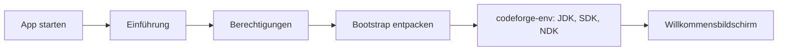

# CodeForge Mobile – Anwenderhandbuch

> English version: [UserGuide.md](UserGuide.md) · Entwicklerdoku: [../dev/DeveloperGuide.md](../dev/DeveloperGuide.md) · APK: [../apk/APK-Dokumentation.md](../apk/APK-Dokumentation.md)

CodeForge Mobile ist eine Entwicklungsumgebung für Android auf dem Smartphone oder Tablet: Code-Editor, Terminal mit Java/Android-SDK, Git, Gradle-Build, Sprachserver (LSP), Compose-Vorschau und Layout-Designer in einer App.

## 1. Installation und erster Start

1. APK installieren (siehe [APK-Dokumentation](../apk/APK-Dokumentation.md)); „Installation aus unbekannten Quellen“ für die installierende App erlauben.
2. Beim ersten Start führt das **Onboarding** durch: Einführung → Berechtigungen → Terminal-Bootstrap → Einrichtungsskript im Terminal.
3. Das Einrichtungsskript `codeforge-env` installiert JDK (17/21), Android-SDK (`$PREFIX/opt/android-sdk`), cmdline-tools, platform-tools, CMake und NDK. Das dauert je nach Verbindung mehrere Minuten; Internet ist nötig.

## 2. Projekte

- **Neues Projekt:** Projekt-Assistent in zwei Schritten mit neun Vorlagen (Compose-App, Empty Activity, Multi-Modul …). Beim Anlegen wird `git init` ausgeführt.
- **Importieren:** per Dateiauswahl (SAF); das Projekt wird einmalig in einen lokalen Ordner kopiert.
- **Git-Clone:** Repository per URL klonen.
- Standardordner: `/storage/emulated/0/CodeForgeMobileProjects/`. IDE-Daten (Logs, Absturzberichte, Arbeitsbereich) liegen in `.cfm/` im Projekt.

## 3. Editor

- Der Editor (Sora) bietet Syntaxfärbung, Zeilenumbruch, Lupe und Sticky-Scroll. Mehrere Dateien öffnen sich in Tabs; beim Schließen mit ungespeicherten Änderungen erscheint ein Speichern/Verwerfen-Dialog.
- **Suchen & Ersetzen** in Datei und Projekt (Regex, Groß-/Kleinschreibung, ganzes Wort).
- **Formatieren:** ein Befehl für Kotlin, Java, XML und JSON (LSP → `ktlint`/`google-java-format` → eingebauter Formatierer); optional beim Speichern.
- **Snippets/Live-Templates:** Kürzel wie `fun`, `fori` in der Autovervollständigung, Tab-Stopps mit `Tab`/`Shift+Tab`; eigene Snippets in den Einstellungen.
- **Hinweise im TOML-Versionskatalog:** neuere Versionen werden angezeigt (`4.0.1 → 4.0.3`) und lassen sich einzeln oder gesammelt aktualisieren; Farbwerte zeigen ein Farbfeld.

### Sprachserver (LSP)

Für Vervollständigung, Hover, Diagnose, Quick-Fixes, Umbenennen (mehrere Dateien, mit Vorschau und Undo), Gliederung, Definition und Referenzen werden Sprachserver als **Plugins** eingebunden (Einstellungen → Plugins). Beispiel-Plugins liegen unter `examples/out/<name>/<name>.zip` (Kotlin, Java, XML, C/C++, Bash, YAML, TOML, Python, kmp-lsp). Pakete wie `clang` oder `taplo` installiert die App nach Bestätigung. Sind für dieselbe Sprache zwei Plugins aktiv, gilt das zuerst geladene.

Läuft ein Server nicht, hilft das Logcat mit dem Tag `CF-LSP` (Start, stderr, Exit-Code).

## 4. Terminal

Ein echtes Termux-Terminal: `pkg install …`, `git`, `gradle`, `codeforge-env`. `codeforge-env pkg <name>` installiert große Pakete (z. B. `clang`) samt Abhängigkeiten.

## 5. Build, Probleme und Logcat

- **Build-Symbol (Schraubenschlüssel)** in der Werkzeugleiste öffnet das Build-Fenster mit den Reitern *Ausgabe*, *Probleme*, *Logcat* und *Tests*.
- **Task-Liste:** Beim Öffnen eines Gradle-Projekts wird einmal `tasks --all` ausgeführt. Der Pfeil neben dem Task-Namen in der Build-Leiste öffnet die durchsuchbare Liste mit Symbolen, Beschreibung und Gruppe; „Ausführen“ startet den gewählten Task. Das Sync-Symbol lädt die Liste neu.
- **Probleme:** Fehler von Kotlin, javac, AAPT2 und Gradle sind anklickbar und springen an `Zeile:Spalte` im Editor.
- **APK installieren/starten:** nach erfolgreichem Build per Tipp installieren (PackageInstaller) und starten; „Build & Run“ erledigt beides.
- **Logcat:** filtert nach Level, Paket, Tag und Text; Abstürze werden gruppiert, Stacktrace-Zeilen führen in den Editor. Quellen: eigener Prozess, `READ_LOGS` (per `adb pm grant`) oder ADB-Loopback.

## 6. Git

Diff, Commit, Push/Pull, Graph, Stash, Tags, Rebase, Cherry-Pick, Revert, Reset, Amend, Blame, Hunk-weises Stagen und Konflikt-Editor. Name, E-Mail und Token (HTTPS) stehen unter Einstellungen → Git.

## 7. Weitere Werkzeuge

| Werkzeug | Zweck |
|---|---|
| Compose-Vorschau | `@Composable`-Funktionen live rendern (Kompilierung über `kotlinc` im Terminal) |
| Layout-Designer | Android-Layout-XML visuell bearbeiten (Palette, Vorschau, Baum, Eigenschaften, Undo/Redo) |
| Theme-Builder | eigene Farbpaletten, 5 Voreinstellungen, dynamische Farben |
| Abhängigkeits-Updates | Versionsprüfung für TOML-Katalog und `build.gradle(.kts)` |
| Signierung, SDK-Manager, Modul-Maker, Asset-Studio, Java→Kotlin, Debugger | siehe jeweilige Bereiche im Seitenmenü |

## 8. KI-Assistent

Unter Einstellungen → KI hinterlegst du API-Schlüssel für Anthropic, OpenAI und Gemini, testest die Verbindung und lädst die verfügbaren Modelle. Die Schlüssel werden mit AES-256-GCM verschlüsselt (Schlüssel im Android Keystore) auf dem Gerät gespeichert.

## 9. Einstellungen und Info

Design (hell/dunkel, dynamische Farben), Editor, Git, KI, Plugins und **Info** (Version, Build, Links). Die App ist adaptiv (Smartphone, Tablet, Foldable) und nutzt die gesamte Bildschirmfläche.

## 10. Fehlerbehebung

| Problem | Lösung |
|---|---|
| App stürzt ab | Absturzbericht liegt in `.cfm/crash/`; bitte mit Version aus *Info* melden |
| Kein Autovervollständigen | Sprachserver-Plugin installiert und aktiv? Logcat-Tag `CF-LSP` prüfen |
| Build schlägt fehl | Reiter *Probleme*; JDK/SDK mit `codeforge-env` prüfen |
| Paket nicht gefunden | im Terminal `pkg update`; große Pakete mit `codeforge-env pkg <name>` |

> **Hinweis:** CodeForge Mobile befindet sich in Entwicklung; der Funktionsumfang entspricht [STATUS.md](../../STATUS.md).
