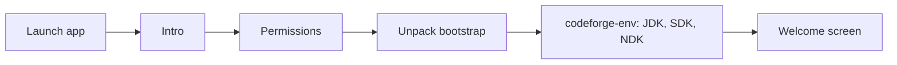

# CodeForge Mobile – User Guide

> Deutsche Version: [Anwenderhandbuch.md](Anwenderhandbuch.md) · Developer docs (German): [../dev/DeveloperGuide.md](../dev/DeveloperGuide.md) · APK: [../apk/APK-Dokumentation.md](../apk/APK-Dokumentation.md)

CodeForge Mobile is a development environment for Android phones and tablets: code editor, terminal with Java and the Android SDK, Git, Gradle builds, language servers (LSP), Compose preview and a layout designer in one app.

## 1. Installation and first start

1. Install the APK (see the [APK documentation](../apk/APK-Dokumentation.md)); allow "install unknown apps" for the installing app.
2. The **onboarding** guides you through: intro → permissions → terminal bootstrap → setup script in the terminal.
3. The setup script `codeforge-env` installs a JDK (17/21), the Android SDK (`$PREFIX/opt/android-sdk`), cmdline-tools, platform-tools, CMake and the NDK. It needs an internet connection and several minutes.

## 2. Projects

- **New project:** two-step wizard with nine templates (Compose app, empty activity, multi-module, …); `git init` runs on creation.
- **Import:** via the file picker (SAF); the project is copied once into a local folder.
- **Git clone:** clone a repository by URL.
- Default folder: `/storage/emulated/0/CodeForgeMobileProjects/`. IDE data (logs, crash reports, workspace) lives in `.cfm/` inside the project.

## 3. Editor

- The Sora-based editor provides syntax highlighting, word wrap, magnifier and sticky scroll. Files open in tabs; closing with unsaved changes asks to save or discard.
- **Find & replace** in file and project (regex, case, whole word).
- **Format:** one command for Kotlin, Java, XML and JSON (LSP → `ktlint`/`google-java-format` → built-in formatter), optionally on save.
- **Snippets / live templates:** abbreviations such as `fun`, `fori` in completion, tab stops with `Tab`/`Shift+Tab`; custom snippets in settings.
- **TOML version-catalog hints:** newer versions are shown (`4.0.1 → 4.0.3`) and can be updated one by one or all at once; colour values show a swatch.

### Language servers (LSP)

Completion, hover, diagnostics, quick fixes, multi-file rename (with preview and undo), outline, definition and references come from language servers installed as **plugins** (Settings → Plugins). Example plugins are in `examples/out/<name>/<name>.zip` (Kotlin, Java, XML, C/C++, Bash, YAML, TOML, Python, kmp-lsp). Packages such as `clang` or `taplo` are installed by the app after confirmation. If two plugins serve the same language, the one loaded first wins.

If a server does not run, check Logcat with the tag `CF-LSP` (start, stderr, exit code).

## 4. Terminal

A real Termux terminal: `pkg install …`, `git`, `gradle`, `codeforge-env`. `codeforge-env pkg <name>` installs large packages (e.g. `clang`) including their dependencies.

## 5. Build, problems and Logcat

- The **build icon (wrench)** opens the build sheet with the tabs *Output*, *Problems*, *Logcat* and *Tests*.
- **Task list:** when a Gradle project is opened, `tasks --all` runs once. The arrow next to the task name in the build bar opens a searchable list with icons, description and group; "Run" starts the selected task. The sync icon reloads the list.
- **Problems:** errors from Kotlin, javac, AAPT2 and Gradle are clickable and jump to `line:column` in the editor.
- **Install/launch APK:** after a successful build, install via PackageInstaller and launch; "Build & Run" does both.
- **Logcat:** filter by level, package, tag and text; crashes are grouped and stack-trace lines lead into the editor. Sources: own process, `READ_LOGS` (granted via `adb pm grant`) or ADB loopback.

## 6. Git

Diff, commit, push/pull, graph, stash, tags, rebase, cherry-pick, revert, reset, amend, blame, hunk-wise staging and a conflict editor. Name, email and (HTTPS) token are set under Settings → Git.

## 7. More tools

| Tool | Purpose |
|---|---|
| Compose preview | Render `@Composable` functions live (compiled via `kotlinc` in the terminal) |
| Layout designer | Edit Android layout XML visually (palette, preview, tree, properties, undo/redo) |
| Theme builder | Custom palettes, 5 presets, dynamic colour |
| Dependency updates | Version check for the TOML catalog and `build.gradle(.kts)` |
| Signing, SDK manager, module maker, asset studio, Java→Kotlin, debugger | see the respective drawer sections |

## 8. AI assistant

Under Settings → AI you store API keys for Anthropic, OpenAI and Gemini, test the connection and load the available models. Keys are stored on the device encrypted with AES-256-GCM (key in the Android Keystore).

## 9. Settings and About

Theme (light/dark, dynamic colour), editor, Git, AI, plugins and **About** (version, build, links). The app is adaptive (phone, tablet, foldable) and edge-to-edge.

## 10. Troubleshooting

| Problem | Fix |
|---|---|
| App crashes | The crash report is in `.cfm/crash/`; please report it with the version from *About* |
| No completion | Is the language-server plugin installed and active? Check Logcat tag `CF-LSP` |
| Build fails | Open the *Problems* tab; verify JDK/SDK with `codeforge-env` |
| Package not found | Run `pkg update`; large packages via `codeforge-env pkg <name>` |

> **Note:** CodeForge Mobile is under development; the feature set matches [STATUS.md](../../STATUS.md).
